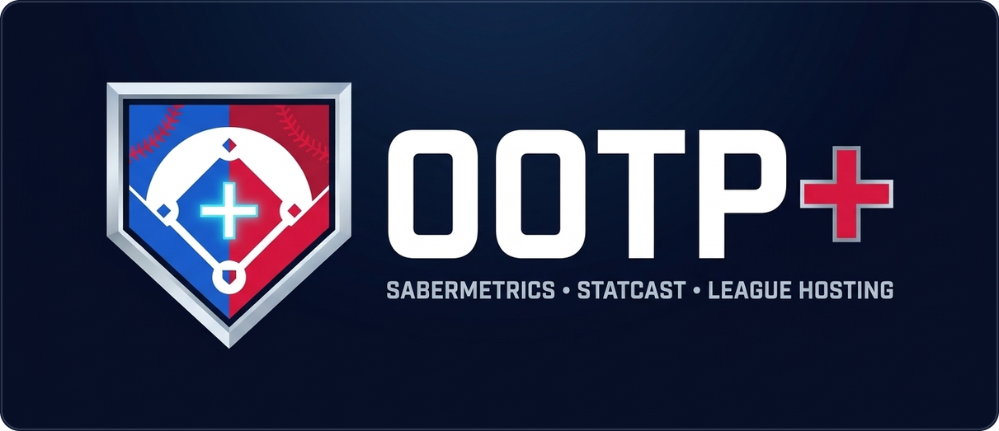
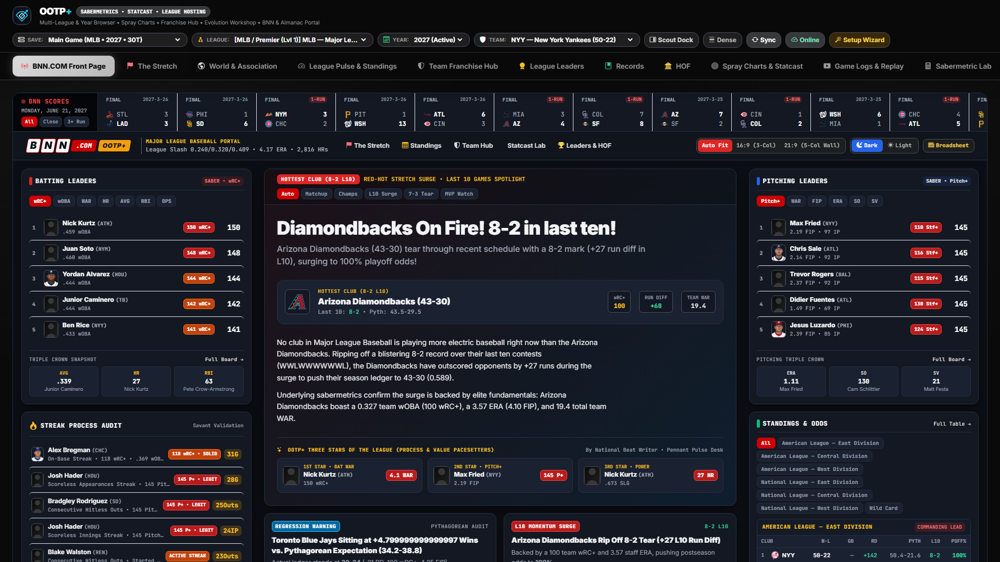

<div align="center">
  

  # OOTP+
  ### Broadcast-Grade Sabermetrics, 3D Statcast, Front-Office Intelligence & Local League Hosting for *Out of the Park Baseball*

  [-3776AB?logo=python&logoColor=white)](https://www.python.org/)
  [](https://www.starlette.io/)
  [-003B57?logo=sqlite&logoColor=white)](https://www.sqlite.org/)
  [](./docs/README.md)
</div>

---

## What Is OOTP+ and What Is It For?

**OOTP+** is a local, zero-cloud web platform and sabermetric command center built for **Out of the Park Baseball 27** *(with full backward compatibility for OOTP 26 and OOTP 25 `.lg` saves)*.

Out of the Park Baseball simulates one of the deepest sports universes ever created—generating millions of plate appearances, multi-tier minor-league ecosystems, scouting snapshots, financial ledgers, and century-long histories. Yet inside the native game client, exploring cross-era sabermetrics, Statcast spray charts, multi-year roster succession, or modern sports-network coverage often requires digging through dozens of static tables.

**OOTP+ bridges that gap.** Running locally on `http://localhost:8080`, it automatically discovers your `.lg` save folders, ingests **71+ OOTP CSV data tables**, archived monthly/yearly dumps, box scores, and BNN HTML almanacs into high-speed **SQLite (`WAL`)** databases, and transforms your baseball world into a living **MLB Network + Baseball Savant + FanGraphs + StatsPlus** experience:

- **For Solo GMs & Franchise Builders:** Audit your roster through an interactive diamond depth chart, **27-metric league rankings**, a **5-Year Projected Starters & Gap Action Plan**, `$/WAR` contract surplus matrices, and a live **Interactive Trade Machine**.
- **For Sabermetric & Statcast Analysts:** Explore era-calibrated `wOBA`, `xwOBA`, `wRC+`, `OPS+`, `FIP`, `xFIP`, `ERA+`, `ZR`, Catcher Framing, and `WAR`, plus ballpark-scaled **3D Statcast Spray Charts**, **Baseball Savant Percentile Dossiers**, and step-by-step **Play-by-Play Game Replays**.
- **For Historical Simmers & World Architects:** Follow your universe through the **BNN.COM | OOTP+ Broadcast Portal**, **Classic Broadsheet Gazette**, **"The Stretch" Pennant & Playoff Hub**, **Cooperstown Hall of Fame JAWS Museum**, **World & Association Dashboard**, and a geospatial **League Evolution & Expansion Workshop** with MSA market capacity and revenue modeling.
- **For Online League Commissioners & GMs:** Import any zipped online league CSV/HTML bundle (`.zip`) in one click, track multi-dump player rating development (`OA`/`POT` risers & fallers), grade league trades, and browse repaired or dynamically generated **BNN HTML & Almanac reports**.



---

## Getting Started Tutorial

Follow this step-by-step walkthrough to go from a fresh download to exploring your own OOTP universe (or the built-in Demo League) in under three minutes.

### Prerequisites
- **Python 3.10 or newer** *(tested on Python 3.12 and Python 3.13)*
- **Windows 10/11**, **macOS**, or **Linux** *(one-click `.bat` / `.vbs` launchers included for Windows)*
- **Out of the Park Baseball 27 / 26 / 25** *(Optional—OOTP+ includes a built-in 16-Team MLB + 16-Team AAA Demo League generator so you can try every feature immediately even before installing or exporting from OOTP)*

---

### Step 1: Run the Setup & Verification Wizard

**On Windows (One-Click):**
Double-click **`Setup_Wizard.bat`** in the project folder.

**From Any Terminal (Windows / macOS / Linux):**
```powershell
python setup_wizard.py
```

The interactive 4-step wizard handles everything automatically:
1. **Dependency Check:** Verifies Python `3.10+`, SQLite WAL support, and automatically installs `requirements.txt` (`uvicorn`, `starlette`, `pandas`, `numpy`, `aiofiles`) if anything is missing.
2. **OOTP Path Auto-Discovery:** Scans `Documents`, `OneDrive`, `AppData`, Steam, macOS, and Linux paths for your OOTP `saved_games` folder (or lets you pick a custom folder).
3. **Save Audit or Instant Demo League:** Lists every `.lg` save found. If you haven't exported CSVs from OOTP yet, select the **Demo League** option (or run `python setup_wizard.py --demo`) to generate **`OOTP27_Demo_League.lg`**—a complete multi-season save with 480+ players, 1,400+ Statcast batted balls, and Hall of Fame legends.
4. **9-Point System Self-Test & Desktop Shortcut:** Ingests your active save into SQLite, verifies all 9 analytical subsystems end-to-end, and optionally creates a **Desktop Shortcut**.

> **Quick Unattended Setup:** Run `python setup_wizard.py --auto` for zero-prompt setup, automatic Demo League fallback if needed, and full 9-point verification.

---

### Step 2: Export CSV Data from OOTP Baseball

To unlock full Sabermetrics, Statcast Spray Charts, 5-Year Franchise Roadmaps, and StatsPlus Development Tracking on **your own OOTP save**:

1. **Open Game Settings:** Load your league in OOTP Baseball and navigate to **Game → Game Settings** in the top menu bar.
2. **Export CSV Tables:**
   - Open the **Database** tab → click **Database Tools** (top-right) → select **Export data to CSV files now** *(writes 71+ tables to `<Your_Save>.lg/import_export/csv/`)*.
   - *Optional for Development Tracking:* Under the **Almanac / Database** settings, enable periodic monthly or yearly CSV dumps (`<Your_Save>.lg/dump/dump_YYYY_MM/`) so OOTP+ can track scouting rating risers and fallers over time.
3. **Include At-Bat / Game Logs for Statcast Spray Charts:**
   - Ensure `players_at_bat_batting_stats.csv` and game batting/pitching logs are enabled in your export options to populate ballpark spray coordinates, exit velocity, and play-by-play replays.
4. **Optional — BNN HTML & Almanacs:**
   - If you generate HTML reports (`news/html/` or `news/almanac_YYYY/`), OOTP+ indexes and repairs them automatically—and if you skip HTML exports, OOTP+ dynamically synthesizes BNN pages straight from SQLite!

---

### Step 3: Launch OOTP+

Choose whichever launch style fits your workflow:

- **One-Click Windows Launcher:** Double-click **`Launch_OOTP27_Hub.bat`** (or **`Launch_OOTP27_Hub.vbs`** for a silent, windowless background desktop app experience).
- **Standalone Chromeless App Window (Edge / Chrome):**
  ```powershell
  python run_server.py --app
  ```
- **Standard Browser Tab (`http://localhost:8080`):**
  ```powershell
  python run_server.py
  ```
- **Headless Local Server Only:**
  ```powershell
  python run_server.py --no-browser
  ```

---

### Step 4: Navigate Your First Session in OOTP+

Once `http://localhost:8080` opens:

1. **Select & Sync Your Save:** Use the **Save** dropdown in the top Command Bar to pick your `.lg` save. Whenever you advance your simulation in OOTP and re-export CSVs, click **`Sync`** in the top-right bar to refresh SQLite in seconds.
2. **Switch Leagues, Seasons, Dumps & Teams:**
   - Use **League** to move seamlessly between Major League (`Lvl 1`), Minor League (`AAA`–`ROK`), and International circuits.
   - Use **Year** and **Dump** to time-travel across historical seasons or monthly snapshots.
   - Use **Team** to set your active franchise perspective across the **Team Franchise Hub** and **StatsPlus** matrices.
3. **Scout Any Player & Pin the Ultrawide Scout Dock:**
   - Click any player's name anywhere in OOTP+—or type their name into **`Quick-Scout Player...`** in the navigation bar—to open their 3-column **Player Analytical Dossier** (Baseball Savant percentiles + `20–80` scouting + FanGraphs career table + personal spray chart).
   - On widescreen or ultrawide displays, click **`Pin to Right Dock`** to keep a live scouting card docked on the right while browsing leaderboards or building trades!
4. **Import an Online League (`.zip`):**
   - Playing in a multiplayer online league? Click **`Online`** in the top bar, upload your commissioner's `.zip` CSV/HTML bundle, and OOTP+ builds a dedicated SQLite database automatically.

---

## Screen-by-Screen Documentation (`/docs`)

Detailed functional guides—complete with screenshots, sub-tab breakdowns, and analytical explanations for every individual screen in **OOTP+**—are organized in the **[`/docs`](./docs/README.md)** directory:

| Guide | Screen / Module | What It Explains |
| :--- | :--- | :--- |
| **[`docs/01`](./docs/01-command-bar-and-setup.md)** | **Command Bar, Setup Wizard & Online Import** | Global Save/League/Year/Dump/Team controls, Quick-Scout search, 4-Step Setup & 9-Point Self-Test Wizard, and Online `.zip` imports. |
| **[`docs/02`](./docs/02-bnn-front-page-and-gazette.md)** | **BNN.COM \| OOTP+ Portal & Broadsheet Gazette** | Live broadcast scoreboard, click-to-recap game switcher, Three Stars of the League, process leaderboards, and Classic Newspaper mode. |
| **[`docs/03`](./docs/03-the-stretch-pennant-hub.md)** | **"The Stretch" Pennant & Postseason Hub** | Multi-league pennant chases, Wild Card cutlines, Magic Numbers, Momentum Worm trajectories, Playoff Brackets & Monte Carlo Matrix. |
| **[`docs/04`](./docs/04-world-and-association.md)** | **World & Association Dashboard** | All-Leagues ecosystem matrix, Organizational Pyramid & Affiliate Power Index, Financial Quadrants, MLE translator & Org Comparator. |
| **[`docs/05`](./docs/05-league-pulse-and-standings.md)** | **League Pulse & Pythagorean Standings** | Dynamic league run-environment & `cFIP` cards, Season Year quick-switcher, recent box scores, and Pythagorean / BaseRuns standings. |
| **[`docs/06`](./docs/06-team-franchise-hub.md)** | **Team Franchise Hub & 5-Year Roadmap** | Diamond Depth Chart (`A+`–`D` grades), **27-Metric League Rankings**, **5-Year Projected Starters Grid**, Gap Action Plan & Contracts. |
| **[`docs/07`](./docs/07-leaders-records-and-hof.md)** | **Leaders, Records Book & Hall of Fame (JAWS)** | Visual top-10 leader cards, Single-Season & Career Records Book, and Cooperstown Hall of Fame plaques with positional **JAWS**. |
| **[`docs/08`](./docs/08-statcast-and-game-replay.md)** | **Spray Charts, 3D Statcast & Game Replay** | Ballpark polar spray charts (`angle_deg`, `distance_ft`, exit velo, barrels) and interactive step-by-step **Play-by-Play Game Replays**. |
| **[`docs/09`](./docs/09-sabermetric-lab-and-projections.md)** | **Sabermetric Lab & Hybrid Projections** | Era-calibrated `wOBA`, `xwOBA`, `wRC+`, `FIP`, `xFIP`, `ERA+`, `ZR`, `WAR`, handedness splits, scatter plots & true-talent projections. |
| **[`docs/10`](./docs/10-league-evolution-and-expansion.md)** | **League Evolution & Expansion Workshop** | Expansion Readiness Index, MSA market capacity & revenue modeling (`Gate / Media / Merch`), interactive SVG map & realignment roadmaps. |
| **[`docs/11`](./docs/11-statsplus-and-trade-machine.md)** | **StatsPlus Portal & Interactive Trade Machine** | Multi-dump rating risers/fallers, Top 100 Prospects & Farm Rankings, `$/WAR` Contract Surplus Matrix, and live **Trade Machine**. |
| **[`docs/12`](./docs/12-bnn-html-and-almanacs.md)** | **OOTP HTML & BNN Almanac Portal** | Embedded native BNN HTML & historical Almanac reader, link/asset rewriter, dynamic SQLite HTML fallback & Ultrawide Split View. |
| **[`docs/13`](./docs/13-player-dossier-and-scout-dock.md)** | **Player Analytical Dossier & Live Scout Dock** | 3-Column Baseball Savant percentile + `20–80` scouting + FanGraphs career modal and persistent right-hand **Ultrawide Scout Dock**. |
| **[`docs/14`](./docs/14-architecture-and-api-reference.md)** | **Architecture, Data Pipeline & REST API** | Mermaid system architecture, SQLite WAL ingestion & offseason fallback, directory map, `user_config.json`, and full REST API reference. |

---

## Diagnostic Self-Test

At any time, you can run OOTP+'s automated **9-Point Functionality Verification Suite** from the command line (or via the in-app **Setup Wizard**) to verify every database table and analytical subsystem:

```powershell
python setup_wizard.py --verify
```
