# OOTP 27 Local Analytics, Statcast & League Hosting Suite (`OOTP-Hosting`)

[-3776AB?logo=python&logoColor=white)](https://www.python.org/)
[](https://www.starlette.io/)
[-003B57?logo=sqlite&logoColor=white)](https://www.sqlite.org/)
[](http://localhost:8080)

The **OOTP 27 Local Analytics, Statcast & League Hosting Suite** is a full-stack local web server, online league hosting environment, and sabermetric intelligence platform built for **Out of the Park Baseball 27** (with backward compatibility for OOTP 26 and OOTP 25 `.lg` saves).

Running locally on `http://localhost:8080`, the suite autonomously discovers active `.lg` save directories, ingests **71+ CSV data tables**, chronological monthly/yearly simulation dumps, box scores, player rating snapshots, and BNN HTML almanacs into index-optimized SQLite databases, and serves **14 specialized broadcast-grade analytical modules** designed for standard, widescreen, and ultrawide (`1800px–2400px+`) displays.

---

## Table of Contents

1. [Key Highlights & Capabilities](#1-key-highlights--capabilities)
2. [Visual Tour & Screenshots](#2-visual-tour--screenshots)
3. [System Architecture & Data Pipeline](#3-system-architecture--data-pipeline)
4. [Comprehensive Module Guide (All 14 Hubs)](#4-comprehensive-module-guide-all-14-hubs)
5. [Project Directory Structure](#5-project-directory-structure)
6. [Getting Started, Setup Wizard & CLI Usage](#6-getting-started-setup-wizard--cli-usage)
7. [Exporting Data from OOTP Baseball 27](#7-exporting-data-from-ootp-baseball-27)
8. [REST API & Endpoint Reference](#8-rest-api--endpoint-reference)
9. [Configuration, Environment Variables & Diagnostics](#9-configuration-environment-variables--diagnostics)

---

## 1. Key Highlights & Capabilities

- **Zero-Config Setup & 9-Point Self-Test Wizard:**
  - Includes both an **In-App 4-Step Setup Wizard** (`http://localhost:8080/?setup=1`) and an interactive **CLI / Batch Setup Wizard** (`Setup_Wizard.bat` / `python setup_wizard.py`).
  - Automatically verifies Python `3.10+`, installs missing packages from `requirements.txt`, scans Documents, OneDrive, AppData, Steam, macOS, and Linux paths for OOTP `saved_games`, and provides a native OS folder picker.
  - **Bundled Multi-Season Demo League Generator (`OOTP27_Demo_League.lg`):** Guarantees 100% out-of-the-box functionality on any machine—even before exporting CSVs from OOTP—by generating a complete 16-Team MLB + 16-Team AAA save with 480+ players, 1,400+ Statcast batted-ball events, multi-year histories, and Cooperstown Hall of Fame legends.
- **Autonomous Multi-Dump SQLite Ingestion (`app/ingestor.py`):**
  - Parses 71+ OOTP CSV tables across `import_export/csv/`, historical `dump/` subdirectories (`dump_YYYY_MM`, `dump_YYYY_yearly`), `news/almanac_YYYY/`, and `messages/`.
  - **Smart Offseason & Preseason Fallback:** Automatically detects header-only (`0`-game) preseason/offseason exports and seamlessly falls back to the most recent completed-season dump or historical career tables so standings, Statcast spray charts, and leaderboards never render empty.
- **Editorial & Postseason Broadcast Hubs:**
  - **Front Page Gazette:** Authentic broadsheet newspaper front page with auto-generated headlines, pennant chase dispatches, active player streaks, wire stories, and box score agate.
  - **"The Stretch" Pennant & Postseason Hub:** Multi-league pennant race tracker with magic numbers, wild card cutlines, season momentum worm trajectories (games above/below `.500`), and live, historical, or projected (*"If Season Ended Today"*) playoff brackets.
  - **World & Association Dashboard:** Holistic macro-analysis of every league tier in your save, featuring an Organizational Pyramid & Affiliate Power Index, Financial Quadrant scatter (`Juggernaut`, `Moneyball Contender`, `Underachiever`, `Rebuilding`), Talent & Age Distribution pyramids, Top 12 International Nations Pipeline, and 25-year historical eras.
- **Deep Franchise & Roster Front-Office Intelligence:**
  - **Team Franchise Hub:** Interactive diamond depth chart with unit grades (`A+` to `D`), **27-Metric League-Wide Team Statistical Rankings** (Offense, Pitching, Defense & Club Value), a **5-Year Projected Starters & Positional Succession Grid** (15 core lineup/rotation/closer roles across 5 seasons), an automated **Positional Gap & Action Plan**, a **5-Year Contract & Age Curve Matrix**, and an organizational **Prospect Pipeline**.
  - **StatsPlus Portal & Interactive Trade Machine:** Multi-snapshot player development rating tracker, Top 100 prospects, farm system rankings, `$/WAR` contract surplus matrices, and a live multi-player trade simulator.
- **Sabermetrics, 3D Statcast & League Evolution:**
  - **Sabermetric Lab & Statcast Visualizer:** Dynamic league-calibrated `wOBA`, `xwOBA`, `wRC+`, `OPS+`, `FIP`, `xFIP`, `ERA+`, `WAR`, `ZR`, Catcher Framing, and polar-to-ballpark spray chart coordinate transformations (`angle_deg`, `distance_ft`, `zone_code`).
  - **League Evolution & Expansion Workshop:** Evaluates candidate expansion cities from `cities.csv` + real-life MLB/MiLB/Indy counterparts, normalizes Metropolitan Statistical Area (MSA) populations, models **Multi-Club Market Capacity (`1` to `2–3 Teams`)**, calculates **Projected Revenue (`Gate / Media / Merch`) & Local/League Market Share %**, builds custom multi-phase Expansion Roadmaps, and computes Haversine travel-optimized divisional realignment blueprints.
- **Ultrawide Command Workspace:**
  - Full-bleed responsive layout with custom breakpoints (`uw: 1800px`, `suw: 2400px`), compact table density toggle, instant column sorting, a 3-column **Player Analytical Dossier Modal**, and a pinnable right-hand **Live Player Scout Dock**.

---

## 2. Visual Tour & Screenshots

| League Pulse & Standings | Team Franchise Hub & 5-Year Roadmap |
| :---: | :---: |
| 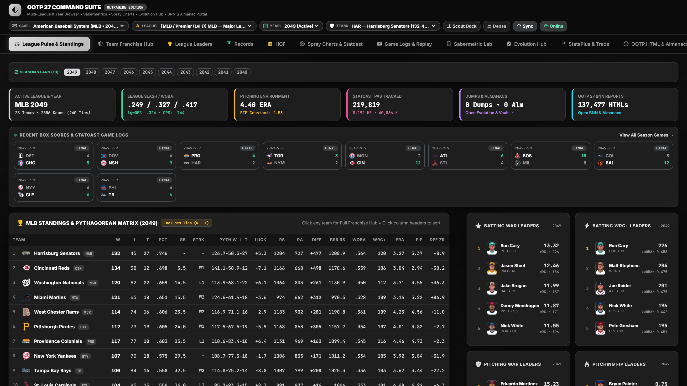 | 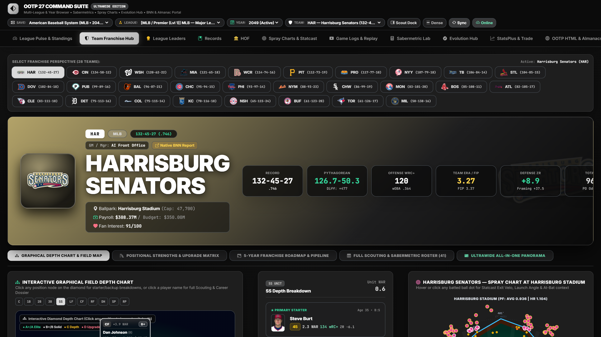 |
| **Spray Charts & Statcast Visualizer** | **Sabermetric Lab** |
| 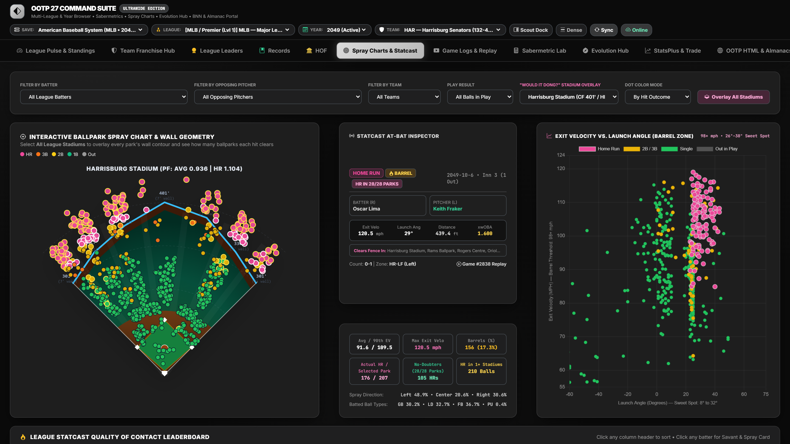 | 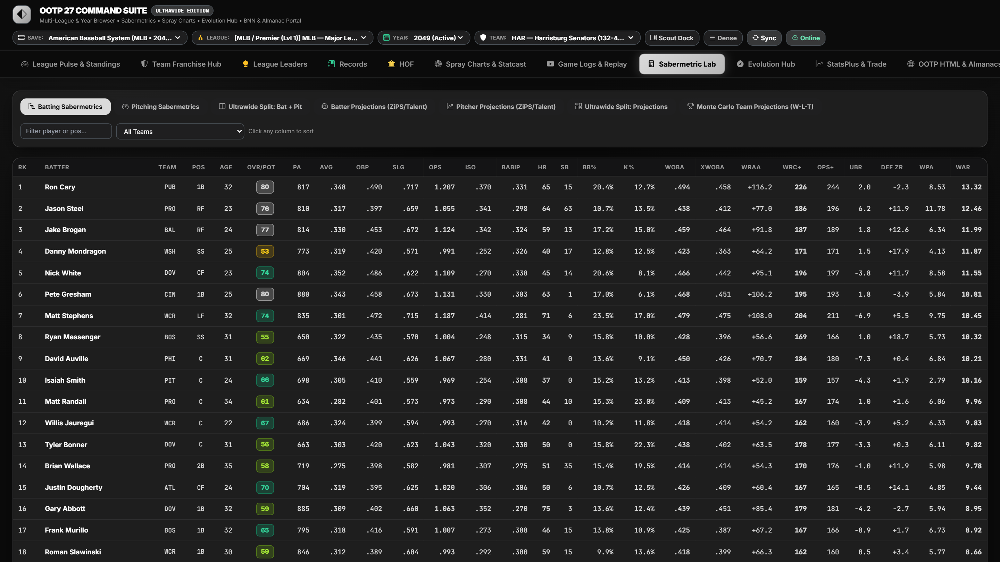 |
| **StatsPlus Player Development Tracker** | **League Evolution & Expansion Hub** |
| 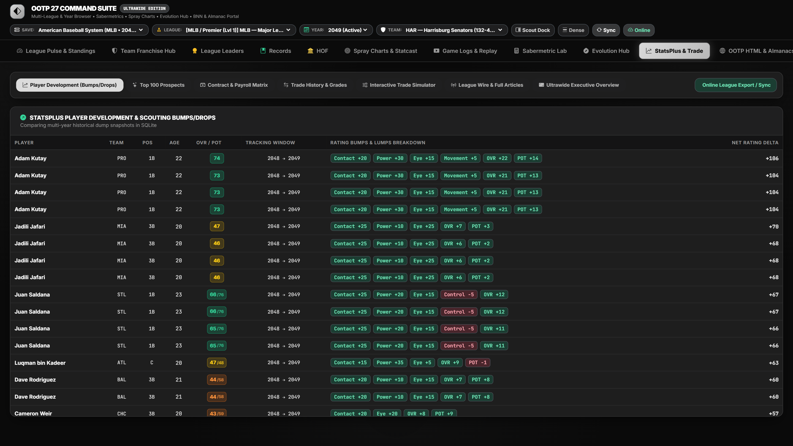 | 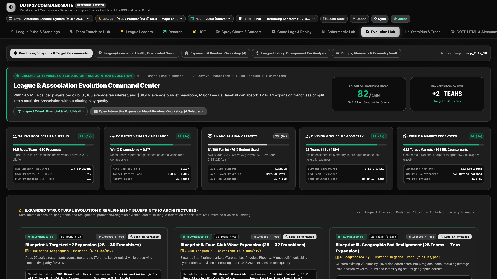 |
| **Cooperstown Hall of Fame & JAWS** | **League Leaders Hub** |
| 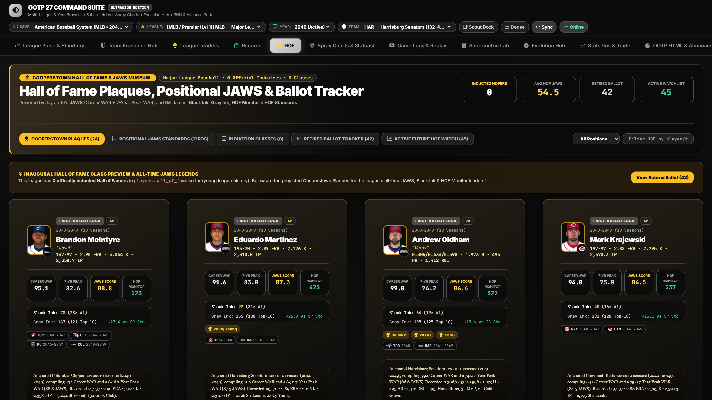 | 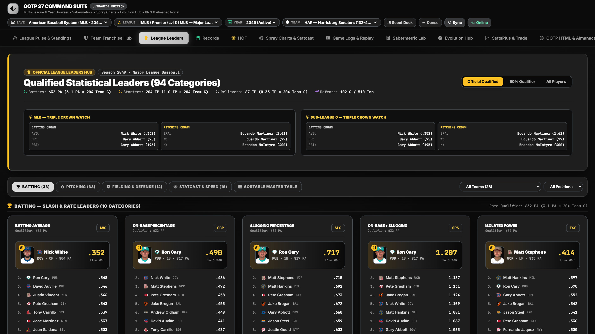 |
| **Player Analytical Dossier** | **Interactive Expansion Roadmap Workshop** |
| 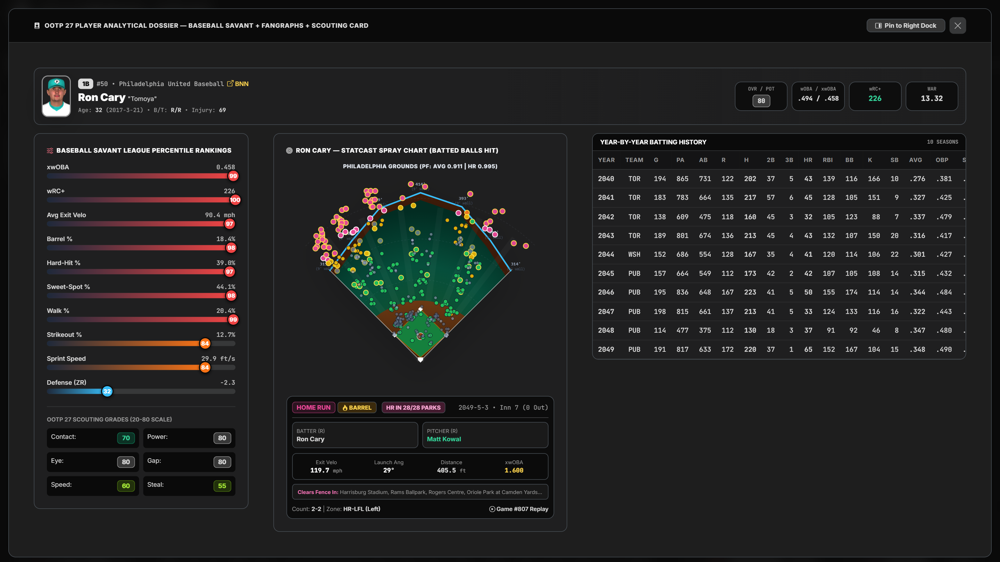 | 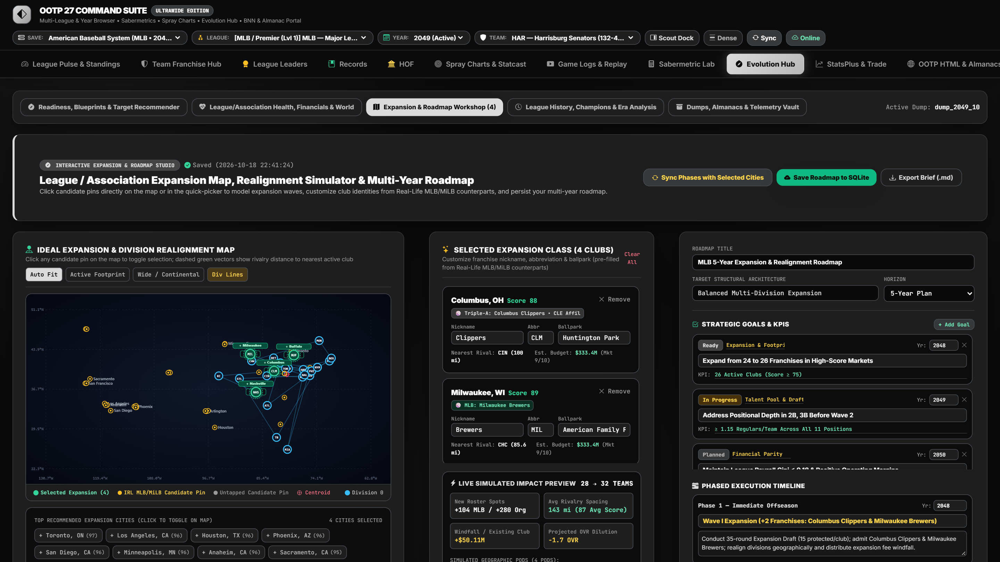 |
| **League Records Book** | **StatsPlus Contracts & Payroll Matrix** |
| 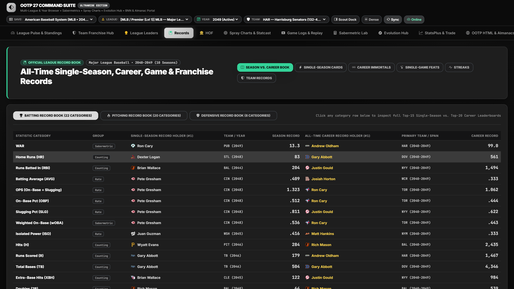 | 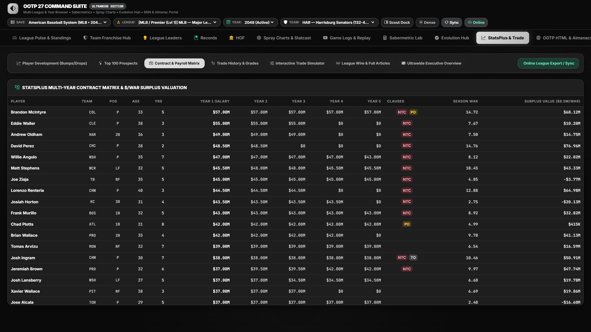 |

---

## 3. System Architecture & Data Pipeline

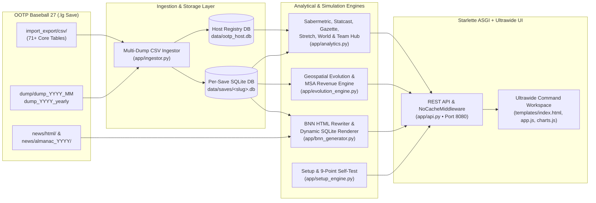

### Core Architectural Pillars

1. **Multi-Source Save Discovery & SQLite WAL Ingestion (`app/ingestor.py`, `app/config.py`):**
   - Scans all candidate OOTP `saved_games` directories plus `data/uploaded_saves/` (for `.zip` online league imports and the bundled Demo League).
   - Streams large historical tables (`>20 MB`) in chunks, builds composite B-tree indexes across `player_id`, `team_id`, `league_id`, `year`, and `split_id`, and enables SQLite `WAL` (Write-Ahead Logging) and memory-mapped I/O pragmas for sub-50ms analytical queries.
   - Compiles cross-dump longitudinal snapshots (`dump_player_rating_snapshots` and `dump_team_snapshots`) so rating progressions and historical team records work across every archived monthly or yearly dump.
2. **Dynamic League-Environment Sabermetric Scaling (`app/analytics.py`):**
   - Rather than hardcoding modern MLB constants, every league-year dynamically calculates its own run environment (`league_avg`, `league_obp`, `league_slg`, `league_ops`, `league_woba`, `fip_constant`, and `runs_per_win`) so historical eras (e.g., 1905 Deadball vs. 1999 Steroid Era vs. 2035 Fictional League) produce accurately scaled `wRC+`, `OPS+`, `ERA+`, `FIP`, and `WAR`.
3. **Geospatial & Metropolitan Market Economics (`app/evolution_engine.py`, `app/irl_counterparts.py`):**
   - Cross-references OOTP's `cities.csv` with a curated registry of real-life MLB, Triple-A, Double-A, High-A, Single-A, Partner/Independent, and international franchises plus MSA reference populations (`METRO_MSA_REFERENCE_POPS`) and metro cluster aliases (`METRO_ALIASES`, e.g., NYC/Brooklyn/Newark, LA/Anaheim, DFW, Bay Area, Twin Cities, Tampa/St. Pete).
   - Evaluates whether a candidate city is **Unserved (Greenfield)**, **Regionally Served (<75 mi)**, **Metro Shared**, or **In-City Shared**, determines **Multi-Club Market Capacity (`1 Team` up to `2–3 Teams`)**, and models projected annual club revenue split across **Gate (40%)**, **Local Media (42%)**, and **Merchandise/Licensing (18%)**.
4. **Always-Fresh ASGI Server Lifecycle (`run_server.py`, `app/api.py`):**
   - `run_server.py` automatically detects and terminates stale background server processes occupying port `8080` before starting Uvicorn, and `NoCacheMiddleware` attaches strict `Cache-Control: no-store, no-cache, must-revalidate, max-age=0` headers so code and data updates appear immediately on browser refresh.

---

## 4. Comprehensive Module Guide (All 14 Hubs)

### 1. Front Page Gazette (`frontpage`)
- **Broadsheet Editorial Layout:** Styled with `Playfair Display` and `Newsreader` typography, featuring a dynamic above-the-fold banner headline, sub-banners, multi-column lead stories, and a selectable headline mode (`Auto`, `Pennant Chase`, `Hot Streaks`, `Recap`, `Offseason`).
- **Live Wire & Agate:** Synthesizes league messages (`messages.csv` + `messages/message_<id>.txt`), recent trades (`trade_history`), active player hitting/pitching streaks (`players_streak`), box score capsules, and league WAR/HR/K/ERA leaders.

### 2. "The Stretch" Pennant & Postseason Hub (`stretch`)
- **Multi-League Race Selector:** Inspect a single league or view all leagues in your association simultaneously (`league_ids=ALL`).
- **Division & Wild Card Cutlines:** Displays W-L records, winning percentages, Games Back (`GB`), Wild Card Games Back (`WCGB`), Run Differential, Pythagorean delta, Magic Numbers, and Clinch/Elimination status tags.
- **Season Momentum Worm Chart:** Plots games above/below `.500` (`G1` through current game) for the top 8 contenders in each league.
- **Interactive Postseason Bracket Tree:** Automatically adapts to the save's phase—rendering live series scores and game logs from `league_playoff_fixtures` during October, reconstructing historical brackets from `team_history` for past seasons, or generating a **"Projected Playoff Bracket (If Season Ended Today)"** with head-to-head series win probabilities during the regular season.

### 3. World & Association Dashboard (`world`)
- **Global KPIs:** Tracks total leagues, competition levels, active/rostered/free-agent/retired/HOF player counts, U24 prospects, `60+ OA` stars, global payroll, global attendance, and historical year span.
- **All-Leagues Ecosystem Matrix:** Side-by-side comparison of every league in the save (Level, Teams, Players, Slash Line, ERA, R/G, Parity Index `0–100`, Average OA/POT/Age, Leader, Champion, and Top WAR Player).
- **Organizational Pyramid & Affiliate Network:** Ranks parent clubs by a composite **Organizational Power Index (`0–100`)** combining MLB win%, minor-league affiliate records (`AAA`, `AA`, `A+`, `A`, `ROK`), U24 farm depth, Top-5 prospect ceiling, and franchise championships.
- **Financial Quadrant & Demographics:** Plots clubs across a 4-quadrant efficiency matrix (`Juggernaut`, `Moneyball Contender`, `Underachiever`, `Rebuilding`), alongside World Talent Tier pyramids, Age Bracket distributions, Top 12 International Nations pipelines, and 25-year macro trends.

### 4. League Pulse & Standings (`overview`)
- Complete sub-league and division standings with Pythagorean W-L, home/away/1-run/extra-inning records, team batting (`RS`, `AVG`, `OBP`, `SLG`, `OPS`, `wOBA`, `wRC+`, `HR`, `SB`, `Bat WAR`), team pitching (`RA`, `ERA`, `FIP`, `ERA+`, `WHIP`, `K`, `SV`, `Pit WAR`), and team defense (`ZR`, `Framing`, `DER`, `FLD%`).

### 5. Team Franchise Hub (`teamhub`)
Organized into three specialized front-office sub-views that automatically synchronize when switching leagues, seasons, or teams:
1. **Diamond Depth Chart & Active Roster:**
   - Interactive baseball diamond mapping starters and top 2 backups across all 9 lineup positions (`C`, `1B`, `2B`, `3B`, `SS`, `LF`, `CF`, `RF`, `DH`), plus the 5-man Starting Rotation (`SP1–SP5`) and Bullpen Corps (`CL`, `SU`, `MR`).
   - Assigns letter grades (`A+` through `D`) and league-wide percentiles (`5th–99th`) to every positional unit.
2. **Positional Strengths, Upgrade Matrix & 27-Metric League Rankings:**
   - Compares team positional WAR against the league average to highlight the **Top 3 Positional Cornerstones** and **Top 3 Priority Upgrade Targets** with tailored GM recommendations.
   - **League-Wide Team Statistical Rankings (`#1` to `#N`):** Ranks the franchise across **27 core metrics** divided into **Offense (10 metrics)**, **Pitching (10 metrics)**, and **Defense & Club Value (7 metrics)**, complete with composite pillar ranks, league averages, and percentile bars.
3. **5-Year Franchise Roadmap, Projected Starters & Gap Engine:**
   - **5-Year Projected Starters & Positional Succession Grid:** Projects the starter for all **15 core roles** (`9 Lineup + SP1..SP5 + CL`) across the next 5 seasons (`Year 0` to `Year +4`), factoring in contract control, age curves, and internal prospect ETAs.
   - **Year-by-Year Potential Gaps & Front-Office Action Plan:** Automatically flags upcoming roster holes caused by **UFA Departures**, **Veteran Age Decline**, **Below-Average Incumbents (`<45 OA`)**, or **Thin Organizational Depth**, and pairs each gap with either an internal **Pipeline Call-Up** or an external **Trade / Free Agency** recommendation.
   - **5-Year Contract & Age Curve Matrix:** Color-coded 5-year grid (`Guaranteed`, `Team/Player Option`, `Pre-Arb`, `Arb Estimate`, `UFA`) with player age-curve classifications (`Ascending Core 📈`, `Prime Window 🔥`, `Veteran Pillar ⚖️`, `Decline Watch ⚠️`), Payroll Horizon vs. Budget charts, and a detailed **Prospect & Young Core Pipeline** table.

### 6. League Leaders Hub (`leaders`)
- Multi-category leaderboards for Batting (`WAR`, `wRC+`, `wOBA`, `OPS`, `AVG`, `HR`, `RBI`, `SB`, `H`, `BB`) and Pitching (`WAR`, `ERA`, `FIP`, `xFIP`, `WHIP`, `K`, `W`, `SV`, `IP`, `K/9`) with year and split filters.

### 7. League Records Book (`records`)
- All-time franchise and league single-season, career, and single-game records reconstructed from almanac histories and career stat tables.

### 8. Cooperstown Hall of Fame & JAWS Museum (`hof`)
- **Inducted Plaques & Positional JAWS:** Calculates Career WAR, 7-Year Peak WAR, and **JAWS (`(Career WAR + Peak WAR) / 2`)** compared against positional Hall of Fame standards (`C`, `1B`, `2B`, `3B`, `SS`, `LF`, `CF`, `RF`, `SP`, `RP`).
- **Bill James Metrics & Active Watchlist:** Computes **Black Ink** (league-leading seasons), **Gray Ink** (top-10 finishes), **HOF Monitor**, and **HOF Standards**, and tracks active veterans on a Hall of Fame trajectory.

### 9. Spray Charts & Statcast Visualizer (`statcast`)
- Translates OOTP at-bat records (`hit_loc`, `hit_xy`, `result`, `exit_velo`, `launch_angle`) via `map_hit_to_spray_coords` into realistic ballpark polar coordinates (`angle_deg` from `-45° LF` to `+45° RF`, `distance_ft`, and OOTP zone codes like `7LD`, `8XD`, `6MD`, `HR-LCF`).
- Filterable by Batter, Pitcher, Team, Opponent, Ballpark, and Batted-Ball Result (`ALL`, `HR`, `XBH`, `HITS`, `OUTS`, `BARRELS`).

### 10. Game Logs & Replay Center (`gamelogs`)
- Browse completed games across the season, inspect inning-by-inning line scores, batting/pitching box scores, and pitch-by-pitch / at-bat play-by-play logs.

### 11. Sabermetric Lab (`sabermetrics`)
- Full-bleed sortable sabermetric workbench with dynamic minimum `PA` / `IP` qualifier sliders, handedness split selectors (`Overall`, `vs LHP`, `vs RHP`), and interactive quadrant scatter plots (`wOBA vs xwOBA`, `FIP vs ERA`, `K% vs BB%`).

### 12. League Evolution & Expansion Hub (`evolution`)
- **Candidate Expansion Market Matrix:** Scores and ranks North American & international markets using MSA population normalization, distance to league centroid, nearest rival distance, and real-life baseball lineage (`MLB`, `AAA`, `AA`, `A+`, `A`, `IND`, `INTL`).
- **Market Service, Multi-Club Capacity & Revenue Modeling:**
  - Shows whether each market is **Unserved**, **Regionally Served**, **Metro Shared**, or **In-City Shared**, along with active in-save clubs and minor-league affiliates.
  - Computes **Supported Teams Capacity** (`1 Team`, `1–2 Teams`, `2 Teams`, `2–3 Teams`) and available team slots (`Open`, `Addl. Slot`, `At Capacity`, `Oversaturated`).
  - Projects annual club **Potential Revenue** (`Gate + Media + Merch`), **Total Metro Revenue Pool**, **Local Market Share %**, and **League Revenue Share %**.
- **Interactive SVG Expansion Map & Multi-Phase Roadmap Workshop:** Click candidate pins on the geographic map to add/remove expansion cities, customize team nicknames/abbreviations, generate Haversine travel-optimized divisional realignment blueprints, and save/export multi-phase Expansion Roadmaps.

### 13. StatsPlus Web Portal & Interactive Trade Machine (`statsplus`)
- **Player Development Tracker:** Compares player ratings (`OA`, `POT`, `CON`, `POW`, `EYE`, `STU`, `MOV`, `CTL`) across chronological CSV dumps to surface top risers and fallers.
- **Top 100 Prospects & Farm Rankings:** Evaluates every organization's minor league system by prospect ceiling and depth.
- **Contract & Payroll Matrix:** Multi-year team salary obligations, expiring contracts, and `$/WAR` surplus efficiency grades.
- **Interactive Trade Machine & Transaction Wire:** Simulate multi-player trades between any two clubs with instant WAR, payroll, and prospect-value balance grading, or audit historical trades from `trade_history`.

### 14. OOTP HTML & BNN Almanac Portal (`bnn`)
- Catalogs and serves native OOTP BNN HTML reports (`news/html/`) and historical almanacs (`news/almanac_YYYY/`) inside the suite.
- Automatically rewrites broken relative OOTP links/assets and dynamically renders BNN-styled HTML pages directly from SQLite whenever disk HTML files were not exported.

### Player Analytical Dossier & Ultrawide Live Scout Dock
- Clicking any player name anywhere in the suite opens the **Player Analytical Dossier** (or updates the pinned right-hand **Ultrawide Live Player Scout Dock**), featuring:
  - **Baseball Savant Percentile Rankings** (`wOBA`, `xwOBA`, `wRC+`, `Exit Velo`, `Barrel%`, `K%`, `BB%`, `FIP`, `ZR`, `WAR`).
  - **20–80 Scouting Grades** (Current vs. Potential across Batting, Pitching, Fielding, and Running tools).
  - **FanGraphs Career Year-by-Year Stat Tables**, trophy case awards, streak logs, contract terms, and personal Statcast spray chart.

---

## 5. Project Directory Structure

```text
OOTP Hosting/
├── app/
│   ├── __init__.py               # Package initialization
│   ├── analytics.py              # Core analytical engine: Sabermetrics, Statcast, Team Hub, 5-Yr Roadmap,
│   │                             #   Leaders, Records, HOF JAWS, Gazette, The Stretch & World Dashboard
│   ├── api.py                    # Starlette ASGI routes, Setup Wizard API, asset servers & NoCacheMiddleware
│   ├── bnn_generator.py          # BNN HTML catalog, link rewriter & dynamic SQLite-to-HTML fallback renderer
│   ├── config.py                 # User config persistence, OOTP path auto-discovery & Statcast zone math
│   ├── evolution_engine.py       # Geospatial Evolution Hub, MSA population/capacity/revenue model & roadmaps
│   ├── ingestor.py               # Multi-dump CSV parser, offseason fallback & SQLite WAL ingestion engine
│   ├── irl_counterparts.py       # Real-life MLB/MiLB/Indy franchise registry, metro aliases & Haversine math
│   └── setup_engine.py           # Setup Wizard backend, 16-team Demo League generator & 9-point self-test
├── data/
│   ├── saves/                    # Per-save SQLite databases (<save_slug>.db, auto-generated)
│   ├── uploaded_saves/           # Staging directory for .zip online league imports & OOTP27_Demo_League.lg
│   ├── ootp_host.db              # Master registry of discovered saves, dumps, almanacs & saved roadmaps
│   └── user_config.json          # Persisted user configuration (saved_games_dir, port, default save)
├── screenshots/                  # 12 high-resolution UI screenshots of all major analytical hubs
├── static/
│   ├── css/
│   │   └── app.css               # Custom dark-mode broadcast styles, glassmorphism & ultrawide density rules
│   ├── js/
│   │   ├── app.js                # Frontend SPA state controller, 14 tab renderers, modals & table sorting
│   │   └── charts.js             # Chart.js visualizers, SVG ballpark spray charts & geographic expansion maps
│   └── ootp27_hub.ico            # Custom application & Windows desktop shortcut icon
├── templates/
│   └── index.html                # Ultrawide responsive HTML5 shell, command bar, Scout Dock & modals
├── create_shortcut.ps1           # PowerShell script to generate the Windows Desktop shortcut & custom icon
├── Launch_OOTP27_Hub.bat         # One-click Windows batch launcher (starts server on Port 8080 & opens UI)
├── Launch_OOTP27_Hub.vbs         # Silent background VBS launcher (windowless desktop app experience)
├── Setup_Wizard.bat              # One-click interactive Setup & 9-Point Verification Wizard launcher
├── setup_wizard.py               # Standalone CLI Setup Wizard, auto-dependency installer & verifier
├── requirements.txt              # Python dependencies (uvicorn, starlette, pandas, numpy, aiofiles)
├── run_server.py                 # Server entry point with stale-port cleanup, auto-demo fallback & browser launch
├── STATUS.md                     # Project architecture & operational status summary
└── README.md                     # Full project documentation
```

---

## 6. Getting Started, Setup Wizard & CLI Usage

### Prerequisites
- **Python 3.10 or newer** (tested on Python 3.12 and Python 3.13)
- **Operating System:** Windows 10/11 (primary launchers), macOS, or Linux
- **Out of the Park Baseball 27 / 26 / 25** *(Optional—the bundled Demo League Generator lets you run and explore every feature even without OOTP installed)*

### Option 1: One-Click Interactive Setup Wizard (Recommended)
Double-click **`Setup_Wizard.bat`** in Windows Explorer, or run from a terminal:
```powershell
python setup_wizard.py
```
The Setup Wizard walks through 4 automated steps:
1. **Runtime & Dependency Check:** Verifies Python `3.10+`, SQLite WAL support, disk space, and automatically runs `pip install -r requirements.txt` if any package is missing.
2. **OOTP Path Discovery:** Auto-detects all OOTP 27/26/25 `saved_games` directories across Documents, OneDrive, AppData, and Steam (or lets you enter/browse a custom folder path).
3. **Save Audit & Demo League Fallback:** Lists all `.lg` saves and their CSV/dump counts. If no CSV exports exist yet, it can generate **`OOTP27_Demo_League.lg`** with one click.
4. **9-Point End-to-End Verification & Desktop Shortcut:** Ingests the active save into SQLite, verifies all 9 analytical subsystems, and optionally creates a **Desktop Shortcut (`OOTP 27 Analytics & Hosting Hub.lnk`)**.

### Option 2: Automated CLI Flags
```powershell
# Unattended setup, automatic Demo League generation if needed, and 9-point verification:
python setup_wizard.py --auto

# Run only the 9-point diagnostic self-test on the currently active save:
python setup_wizard.py --verify

# Generate or refresh the bundled 16-Team Demo League (OOTP27_Demo_League.lg) and verify:
python setup_wizard.py --demo
```

### Option 3: Launch the Web Suite Directly
Double-click **`Launch_OOTP27_Hub.bat`** (or **`Launch_OOTP27_Hub.vbs`** for silent background mode), or run:
```powershell
# Launch server on http://localhost:8080 and open in standalone app window:
python run_server.py --app

# Launch server and open in default browser tab:
python run_server.py

# Launch server headless without opening a browser window:
python run_server.py --no-browser
```
> **Tip:** If a previous background instance is already holding port `8080`, `run_server.py` automatically terminates the stale process and restarts cleanly so the latest code and database state are always served.

---

## 7. Exporting Data from OOTP Baseball 27

To analyze your own OOTP 27 save with full Sabermetrics, Statcast Spray Charts, and Multi-Year Evolution features:

1. **Open League Settings in OOTP 27:**
   Load your save in OOTP Baseball 27 and navigate to **Game → Game Settings** in the top menu.
2. **Enable Almanac / Database Data Dumps:**
   Go to the **Almanac** or **Database** tab and click **Dump Data to CSV** (or **Export Data to CSV Files**).
   - Standard exports write to: `<Your_Save>.lg/import_export/csv/`
   - Monthly/Yearly dumps write to: `<Your_Save>.lg/dump/dump_YYYY_MM/` or `dump_YYYY_yearly/`
3. **Include Pitch / At-Bat Logs for 3D Statcast Spray Charts:**
   Ensure `players_at_bat_batting_stats.csv` (or game batting/pitching logs) is enabled in your export settings to populate exit velocity, launch angle, and spray chart coordinates.
4. **Click `Sync` in the Command Bar:**
   In the web interface at `http://localhost:8080`, select your save from the **Save** dropdown in the top bar and click **`Sync`** (or switch between chronological dumps using the **Dump** dropdown).

### Importing an Online League Archive (`.zip`)
Click the **`Online`** button in the top command bar to upload a `.zip` archive containing an online league's `csv/` and/or `html/` export folders. The suite extracts the archive into `data/uploaded_saves/<slug>.lg` and builds a dedicated SQLite database automatically.

---

## 8. REST API & Endpoint Reference

All endpoints are served asynchronously by Starlette (`app/api.py`) on `http://localhost:8080` with `NoCacheMiddleware` enabled.

### Setup & Verification Endpoints

| Method | Endpoint | Description |
| :--- | :--- | :--- |
| `GET` | `/api/setup/status` | Returns Python/SQLite environment health, candidate OOTP folders, discovered `.lg` saves, and step-by-step OOTP CSV export instructions. |
| `POST` | `/api/setup/config` | Updates `data/user_config.json` (`saved_games_dir`, `default_save_slug`, `port`) and triggers optional re-ingestion. |
| `POST` | `/api/setup/browse` | Opens a native OS folder selection dialog (`tkinter` / PowerShell fallback) and returns the selected path. |
| `POST` | `/api/setup/demo` | Generates and ingests the bundled multi-season `OOTP27_Demo_League.lg` save. |
| `GET`/`POST` | `/api/setup/verify` | Executes the 9-point end-to-end functionality self-test against the active or specified `save_slug`. |
| `POST` | `/api/setup/shortcut` | Executes `create_shortcut.ps1` to create the Windows Desktop shortcut with custom icon. |

### Save Management & Core Analytical Endpoints

| Method | Endpoint | Query / Body Parameters | Description |
| :--- | :--- | :--- | :--- |
| `GET` | `/api/saves` | — | Lists all discovered saves from `ootp_host.db` and returns the active `save_slug`. |
| `POST` | `/api/saves/select` | `{save_slug, force, source_label}` | Selects the active save, optionally switches to a specific monthly/yearly dump, and ingests into SQLite. |
| `POST` | `/api/saves/upload` | `?name=<LeagueName>` (raw `.zip` body) | Imports a zipped online league CSV/HTML export and builds its SQLite database. |
| `GET` | `/api/frontpage` | `save`, `league_id`, `year`, `headline_mode` | Returns the **Front Page Gazette** broadsheet stories, headlines, streaks, box scores, and leaders. |
| `GET` | `/api/stretch` | `save`, `league_id`, `league_ids`, `year` | Returns **"The Stretch"** pennant races, wild card cutlines, magic numbers, momentum trajectories, and playoff brackets. |
| `GET` | `/api/world_dashboard` | `save`, `year` | Returns the **World & Association Dashboard** ecosystem matrix, organizational pyramid, financials, demographics, and international pipelines. |
| `GET` | `/api/overview` | `save`, `league_id`, `team_id`, `year` | Returns **League Pulse & Standings**, division tables, run environment constants, and team splits. |
| `GET` | `/api/team_dashboard` | `save`, `league_id`, `team_id`, `year` | Returns the **Team Franchise Hub**: diamond depth chart, positional strength matrix, **27-metric league rankings**, and **5-Year Franchise Roadmap** (projected starters, gaps, contracts, pipeline). |
| `GET` | `/api/leaders` | `save`, `league_id`, `year`, `split_id` | Returns **League Leaders** across batting and pitching categories. |
| `GET` | `/api/records` | `save`, `league_id` | Returns the **League Records Book** (career, single-season, and single-game records). |
| `GET` | `/api/hof` | `save`, `league_id` | Returns the **Cooperstown Hall of Fame & JAWS Museum** plaques, positional JAWS benchmarks, Black/Gray Ink, and active watchlist. |
| `GET` | `/api/sabermetrics` | `save`, `league_id`, `team_id`, `split_id`, `min_pa`, `min_ip`, `year` | Returns full **Sabermetric Lab** batting, pitching, and fielding leaderboards and scatter datasets. |
| `GET` | `/api/spray` | `save`, `player_id`, `opponent_id`, `team_id`, `game_id`, `park_id`, `result`, `limit` | Returns **3D Statcast & Spray Chart** coordinates (`angle_deg`, `distance_ft`, `zone_code`), ballpark dimensions, and directional splits. |
| `GET` | `/api/games` | `save`, `game_id`, `team_id`, `limit` | Returns **Game Logs & Replay** scoreboards, box scores, and play-by-play events. |
| `GET` | `/api/player/{player_id}` | `save` | Returns the complete **Player Analytical Dossier** (Savant percentiles, 20–80 ratings, career tables, contract, awards, spray chart). |
| `GET` | `/api/projections` | `save`, `league_id`, `team_id`, `year` | Returns multi-year player and team statistical projections. |
| `GET` | `/api/statsplus` | `save`, `league_id`, `team_id`, `year` | Returns **StatsPlus** development tracker deltas, Top 100 prospects, farm rankings, contract matrix, and trade wire. |
| `GET` | `/api/evolution` | `save`, `league_id`, `year` | Returns the **League Evolution & Expansion Hub** candidate markets, MSA capacity/revenue metrics, and realignment blueprints. |
| `GET`/`POST` | `/api/evolution/roadmap` | `save`, `league_id` (or JSON roadmap body) | Loads or persists custom multi-phase Expansion & Realignment Roadmaps in `ootp_host.db`. |
| `GET` | `/api/bnn/catalog` | `save`, `league_id` | Lists available native BNN HTML reports and historical almanac archives. |
| `GET` | `/bnn/{save_slug}/{path}` | — | Serves rewritten native BNN HTML reports or dynamically generates SQLite-backed BNN pages. |
| `GET` | `/ootp_asset/{save_slug}/{asset_type}/{filename}` | — | Serves team logos, league logos, ballpark images, or player portraits with high-contrast SVG fallbacks. |

---

## 9. Configuration, Environment Variables & Diagnostics

### User Configuration (`data/user_config.json`)
Settings configured via the Setup Wizard are persisted in `data/user_config.json`:
```json
{
  "saved_games_dir": "C:\\Users\\<User>\\Documents\\Out of the Park Developments\\OOTP Baseball 27\\saved_games",
  "extra_save_dirs": [],
  "port": 8080,
  "host": "0.0.0.0",
  "app_mode": true,
  "setup_completed": true,
  "default_save_slug": "american_baseball_system"
}
```

### Environment Variables
You can override default paths or network bindings via environment variables:
- `OOTP_SAVED_GAMES_DIR`: Custom path to your OOTP `saved_games` folder.
- `OOTP_PORT`: HTTP port for Uvicorn (default: `8080`).
- `OOTP_HOST`: Bind address (default: `0.0.0.0`).

### 9-Point Functionality Verification Suite
Running `python setup_wizard.py --verify` (or clicking **Run 9-Point Self-Test** in the Setup Wizard modal) validates every subsystem end-to-end:
1. **Python Runtime & ASGI Dependencies** (`starlette`, `uvicorn`, `pandas`, `numpy`, `aiofiles`, SQLite WAL)
2. **OOTP Save Discovery & Multi-Dump SQLite Ingestion** (`ootp_host.db` & `data/saves/<slug>.db`)
3. **League Pulse, Standings & Pythagorean Engine** (`get_save_overview`)
4. **Team Franchise Hub, 27-Metric Rankings & 5-Year Roadmap** (`get_team_dashboard`)
5. **Sabermetric Lab & League Leaders Hub** (`get_sabermetric_leaderboards`, `get_league_leaders_hub`)
6. **3D Statcast & Spray Chart Coordinate Engine** (`get_spray_chart_data`)
7. **StatsPlus Portal, Development Tracker & Trade Machine** (`get_statsplus_reports`)
8. **Cooperstown Hall of Fame JAWS & League Records Book** (`get_hall_of_fame_hub`, `get_league_records_book`)
9. **League Evolution Hub, BNN Almanacs, Front Page Gazette, The Stretch & World Dashboard** (`get_league_evolution_hub`, `get_newspaper_front_page`, `get_stretch_hub`, `get_world_dashboard`)
