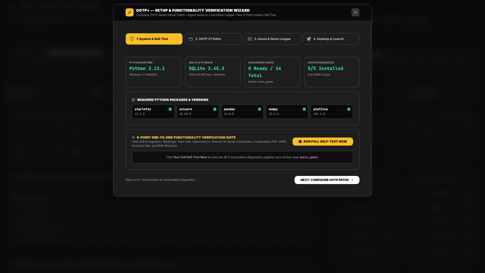
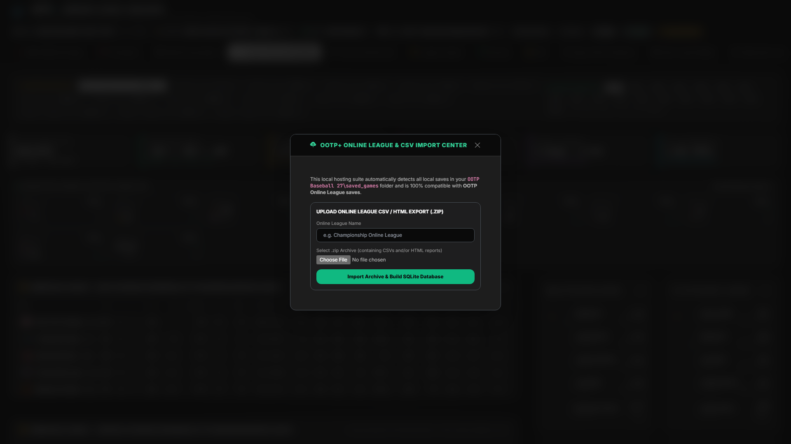

# Global Command Bar, Setup Wizard & Online League Import

[← Back to Main README](../README.md) • [Documentation Index](./README.md) • [Next: BNN.COM | OOTP+ Front Page →](./02-bnn-front-page-and-gazette.md)

---

Every screen in **OOTP+** shares a persistent, sticky **Top Broadcast Command Bar** that controls which save, league tier, season year, chronological CSV dump, and team perspective you are analyzing, along with one-click access to the **4-Step Setup Wizard** and **Online League Import Center**.

---

## 1. The Global Broadcast Command Bar

Located at the top of the workspace across all 14 analytical hubs, the Command Bar provides instant context switching without losing your current screen:

| Control | Function |
| :--- | :--- |
| **Save Selector** | Switches between any discovered local `.lg` save in your OOTP `saved_games` folder, uploaded `.zip` online league archives, or the bundled `OOTP27_Demo_League`. |
| **League Selector** | Filters analytics to any league tier in your universe (e.g., `[MLB / Premier (Lvl 1)]`, `AAA`, `AA`, `A+`, `A`, `ROK`, international leagues, or independent circuits). |
| **Year Selector** | Time-travels across active and historical seasons ingested from career tables, yearly dumps, and almanacs. |
| **Dump Selector** | Switches between `import_export/csv` and archived chronological snapshots (`dump_YYYY_MM`, `dump_YYYY_yearly`) to inspect your league at a specific in-game date. |
| **Team Selector** | Sets your active franchise perspective, dynamically theming team accents and synchronizing the **Team Franchise Hub**, **StatsPlus Contracts**, and **Sabermetric Lab** filters. |
| **Scout Dock** | Opens or collapses the persistent right-hand **Ultrawide Live Player Scout Dock** (`xl` / `uw` / `suw` monitors) so you can inspect player cards alongside tables. |
| **Dense** | Toggles high-density compact table rows for ultrawide displays (`1800px–2400px+`), fitting up to 40% more player rows above the fold. |
| **Sync** | Re-scans your active `.lg` folder on disk and re-ingests any updated CSV exports or new chronological dumps into SQLite on demand. |
| **Online** | Opens the **Online League & CSV Import Center** modal for `.zip` archive uploads. |
| **Setup Wizard** | Launches the interactive **4-Step Setup & 9-Point Verification Wizard** modal. |
| **Quick-Scout Player** | Instant typeahead search box in the secondary navigation bar—type any player name, team abbreviation, or position to open their **Player Analytical Dossier** from anywhere in OOTP+. |

> **Universal Table Sorting:** Every statistical table in OOTP+ (`.saber-table`) supports instant client-side sorting. Click any column header once for descending order and again for ascending order—handling currency (`$12.50M`), `W-L-T` records (`98-64`), scouting slashes (`65/80`), percentages, and decimals automatically.

---

## 2. Setup & 9-Point Functionality Verification Wizard

Accessible anytime via the **Setup Wizard** button in the top bar, via `http://localhost:8080/?setup=1`, or from the command line (`Setup_Wizard.bat` / `python setup_wizard.py`), the wizard guarantees zero-friction configuration:

1. **Step 1 — Python Runtime & Storage Health:**
   - Verifies Python `3.10+`, SQLite `WAL` (Write-Ahead Logging) capability, and writable disk space in `data/`.
   - Checks all required ASGI and data packages (`starlette`, `uvicorn`, `pandas`, `numpy`, `aiofiles`) and installs missing dependencies automatically when run from CLI.
2. **Step 2 — OOTP Saved Games Path Discovery:**
   - Automatically scans candidate OOTP 27, OOTP 26, and OOTP 25 `saved_games` directories across Windows (`Documents`, `OneDrive`, `AppData`, Steam), macOS, and Linux.
   - Includes a **Browse Native Folder** button (`POST /api/setup/browse`) that opens a native OS folder selection dialog, and normalizes parent folder selections into `saved_games` automatically.
3. **Step 3 — Save Audit & Demo League Generator:**
   - Audits every discovered `.lg` directory and classifies its readiness:
     - **Full Analytics Ready:** `5+` core CSV tables found in `import_export/csv/` or `dump/`.
     - **BNN HTML Only:** HTML reports found in `news/html/` (prompts you to export CSVs for full Sabermetrics & Statcast).
     - **No Exports Yet:** Guides you step-by-step through exporting CSVs from OOTP.
   - **One-Click Demo League (`OOTP27_Demo_League.lg`):** Generates a complete multi-season 16-Team MLB + 16-Team AAA save with 480+ players, 1,400+ Statcast batted-ball events, and Cooperstown Hall of Fame legends so you can test every screen immediately—even without OOTP installed.
4. **Step 4 — 9-Point End-to-End Self-Test & Desktop Shortcut:**
   - Executes live diagnostic checks across all 9 analytical engines (Runtime, Host Registry, Multi-Dump SQLite Ingestion, Standings & Team Hub, Sabermetrics & Leaders, 3D Statcast Coordinates, StatsPlus & HOF JAWS, Evolution & BNN Almanacs, and Front Page / The Stretch / World Dashboard) with millisecond timing reports.
   - Optionally creates a Windows Desktop shortcut (`create_shortcut.ps1`) that launches OOTP+ in standalone chromeless app mode.

---

## 3. Online League & `.zip` Archive Import Center

Commissioners and GMs in multiplayer OOTP Online Leagues often distribute weekly or sim-by-sim CSV/HTML bundles rather than full multi-gigabyte `.lg` folders.

- Click **Online** in the top Command Bar to open the **Online League & CSV Import Center**.
- Enter a display name for your league (e.g., *Championship Online League*) and choose a `.zip` archive containing exported `csv/` tables and/or `html/` BNN reports.
- Click **Import Archive & Build SQLite Database** (`POST /api/saves/upload`):
  - OOTP+ extracts the archive cleanly into `data/uploaded_saves/<league_slug>.lg`.
  - Runs the full SQLite WAL ingestion pipeline, builds composite indexes, registers the league in `data/ootp_host.db`, and switches the UI immediately to the newly imported league.

---

[← Back to Main README](../README.md) • [Documentation Index](./README.md) • [Next: BNN.COM | OOTP+ Front Page →](./02-bnn-front-page-and-gazette.md)
