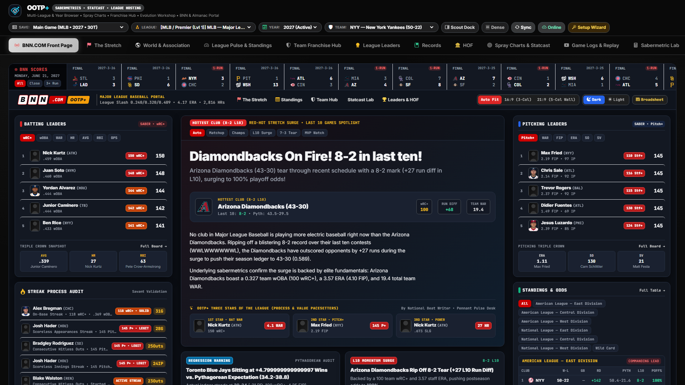
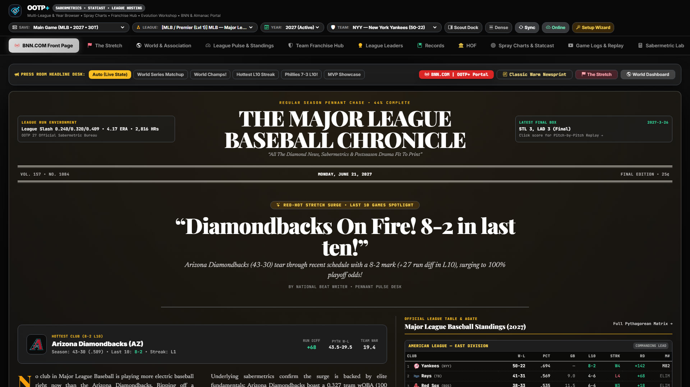

# BNN.COM | OOTP+ Broadcast Portal & Front Page Gazette

[← Previous: Command Bar & Setup](./01-command-bar-and-setup.md) • [Documentation Index](./README.md) • [Next: "The Stretch" Pennant Hub →](./03-the-stretch-pennant-hub.md)

---

The **BNN.COM Front Page** (`frontpage`) is the default landing screen of **OOTP+**. It transforms your active simulation date into a living sports media network with two interchangeable editorial layouts:

1. **BNN.COM | OOTP+ Sports Broadcast Portal** *(Default)* — A modern ESPN / MLB.com / Baseball Savant broadcast desk.
2. **Classic Broadsheet Gazette** — An authentic multi-column print sports newspaper front page.

---

## 1. Mode A: BNN.COM | OOTP+ Broadcast Portal

Designed to feel like opening a live national baseball network portal after every simulation week, the **BNN.COM | OOTP+ Portal** synthesizes box scores, league news, sabermetric leaders, and pennant races into a single scannable command desk.

### Key Functions & Interactive Controls

- **Live Broadcast Scoreboard Strip:**
  - Displays recent completed games across the active league with team logos, final scores, winning/losing decisions, and game margin tags.
  - **Score Filter Pills (`ALL`, `CLOSE`, `BLOWOUT`):** Filter the ticker instantly to 1-run/extra-inning nail-biters or lopsided offensive explosions.
  - **Interactive Game Recap Switcher:** Click any game card in the top scoreboard strip to swap the main hero lead story into a dedicated broadcast game recap with top performers and a direct jump button into the **Game Logs & Play-by-Play Replay Center**.
- **Hero Lead Story & Headline Mode Selector:**
  - Automatically crafts narrative headlines and lead dispatches from live simulation state—pennant race showdowns, championship clinchers, scorching team runs, hot player streaks, or superstar milestones.
  - Switch between editorial angles on demand (`Auto`, `Matchup`, `Champions`, `Team Streak`, `Hot Streak`, `Superstar`) to spotlight different storylines in your league.
- **OOTP+ Three Stars of the League Spotlight Bar:**
  - Highlights the top 3 process-and-value pacesetters across your league (`WAR`, `wRC+`, `xwOBA`, `FIP`, `ERA+`) with clickable player portraits that open their **Player Analytical Dossier**.
- **Interactive Standings & Wild Card Cutline Rail:**
  - Toggle between `ALL` divisions, specific division races, or the `WC` (Wild Card) chase without leaving the front page.
- **Process & Value Leaderboards (Batting & Pitching Switchers):**
  - Cycle Batting leader pills across `wRC+`, `wOBA`, `WAR`, `HR`, `AVG`, `RBI`, and `OPS`.
  - Cycle Pitching leader pills across `ERA+`, `WAR`, `FIP`, `ERA`, `K`, and `SV`.
- **Ergonomic Viewport & Theme Controls:**
  - Switch between **Dark Broadcast** and **Light Editorial** themes, and toggle between **Standard 16:9 (3-Column)** and **Ultrawide 21:9 (5-Column Wall)** layouts.

---

## 2. Mode B: Classic Broadsheet Gazette

Click the **Broadsheet Gazette** layout toggle in the portal toolbar to switch to a traditional print sports page typeset in `Playfair Display` and `Newsreader`:

- **Above-the-Fold Masthead & Banner Headline:** Features your league's official masthead, in-game dateline, run-environment edition stamp, and multi-deck lead banner story.
- **League Wire & Transaction Dispatches:** Parses `messages.csv` and full `messages/message_<id>.txt` bodies alongside `trade_history` to surface injuries, extensions, call-ups, awards, and blockbuster trades.
- **Active Hitting & Pitching Streaks:** Surfaces live multi-game hitting streaks, scoreless inning runs, and hot/cold streaks from `players_streak`.
- **Agate Box Score Capsules & Standings Ledger:** Compact newspaper agate summaries for rapid morning-paper scanning, plus a **Paper Theme** toggle (dark newsprint vs. classic warm ivory newsprint).

---

[← Previous: Command Bar & Setup](./01-command-bar-and-setup.md) • [Documentation Index](./README.md) • [Next: "The Stretch" Pennant Hub →](./03-the-stretch-pennant-hub.md)
