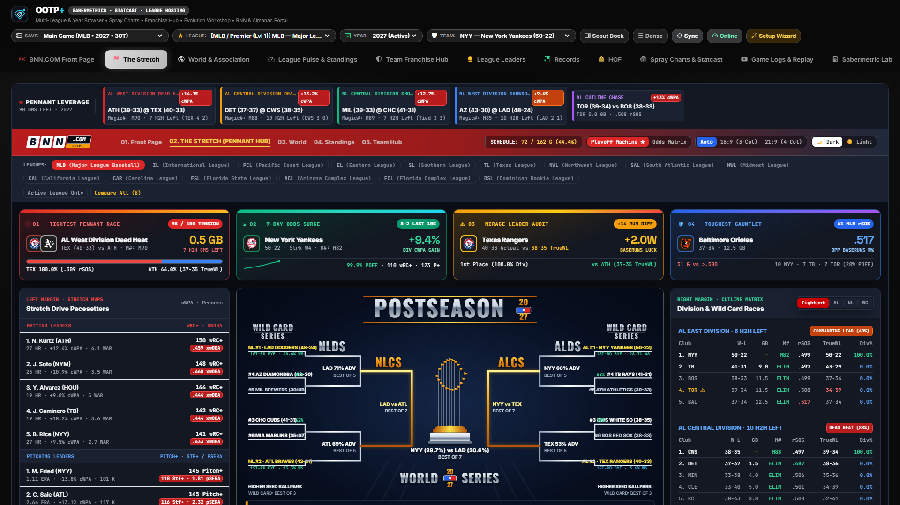
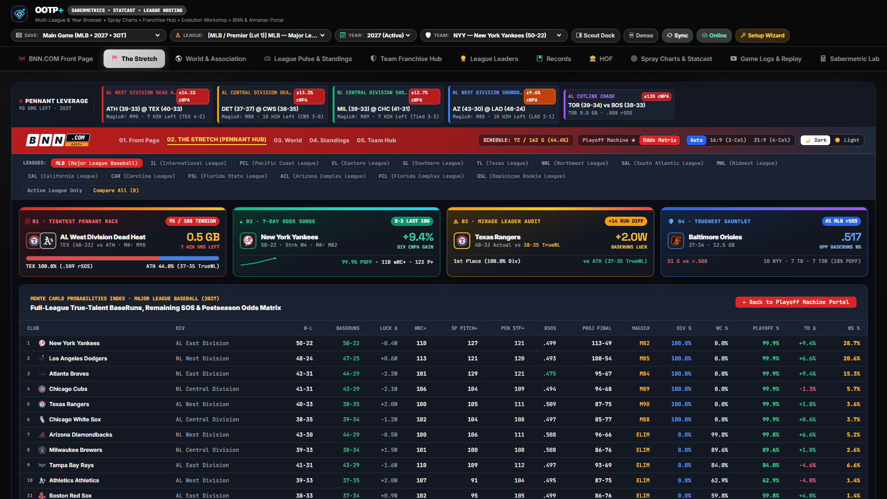

# "The Stretch" — Pennant Race, Playoff Odds & Postseason Hub

[← Previous: BNN.COM | OOTP+ Front Page](./02-bnn-front-page-and-gazette.md) • [Documentation Index](./README.md) • [Next: World & Association →](./04-world-and-association.md)

---

**"The Stretch"** (`stretch`) is OOTP+'s dedicated pennant chase, playoff probability, and October bracket broadcast center. Whether your league is in May, the September stretch run, the middle of the World Series, or reviewing a completed historical season, The Stretch adapts automatically to the phase of your calendar.

---

## 1. Playoff Machine Portal & Broadcast Bracket Poster

### Key Functions & Interactive Controls

- **Multi-League Association Race Bar:**
  - Toggle individual leagues on or off—or select **All Leagues (`ALL`)**—to track simultaneous pennant races across MLB, international leagues, or minor-league tiers on a single screen.
- **Adaptive Postseason Bracket Poster:**
  - **Regular Season (*"If Season Ended Today"*):** Projects division winners and Wild Card seeds automatically, rendering a complete visual playoff tree with head-to-head series win probabilities derived from true-talent Pythagorean/BaseRuns strength.
  - **Live October Postseason:** Reads active playoff series directly from `league_playoff_fixtures` and completed game logs to display live series scores (`3-2`), game-by-game results, and advancing clubs.
  - **Completed Historical Seasons:** Reconstructs past postseason brackets and championship paths from `team_history` and playoff records.
  - **Interactive Series Matchup Inspector:** Click any series card in the bracket tree to inspect head-to-head offense (`wRC+`, `RS/G`), pitching (`FIP`, `ERA`), Pythagorean true talent, and key star matchups.
- **Season Momentum Worm Chart (3 Analytical Modes):**
  - Plots longitudinal trajectories from Game 1 through the current game date for top contenders, switchable across three lenses:
    1. **Playoff Odds %** — Rolling postseason probability curve.
    2. **Games Above / Below `.500`** — Classic pennant race momentum worm.
    3. **Rolling Team Strength (`xwOBA` / Run Diff)** — Underlying process trajectory.
- **Tightest Races & Wild Card Cutline Rail:**
  - Filter the right-hand race rail between **Tightest Races**, **Sub-League 1**, **Sub-League 2**, and **Wild Card Cutline** (`GB`, `WCGB`, Magic Numbers, and Clinch/Elimination status badges).

---

## 2. Monte Carlo Contender Matrix View

Switch the header toggle from **Portal View** to **Monte Carlo Matrix** for a full-bleed front-office probability table across every club in the league:

- **Current vs. True-Talent Record:** Compares actual `W-L` and `PCT` against **Pythagorean W-L**, **Run Differential**, and **Luck Delta** to expose overachieving paper tigers and unlucky sleeping giants.
- **Projected Final Record & Remaining Schedule Context:** Extrapolates end-of-season win totals using remaining games (`Scheduled Games - Games Played`) blended with true-talent run prevention and run scoring.
- **Division, Wild Card, Make Playoffs & Championship Odds:** Full sortable probability columns (`Div %`, `WC %`, `Playoff %`, `Title %`) alongside **Magic Numbers** and elimination counters.

---

[← Previous: BNN.COM | OOTP+ Front Page](./02-bnn-front-page-and-gazette.md) • [Documentation Index](./README.md) • [Next: World & Association →](./04-world-and-association.md)
