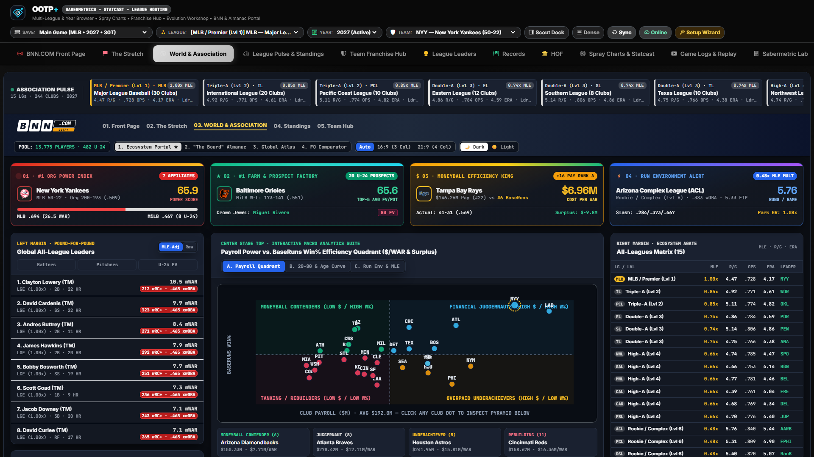
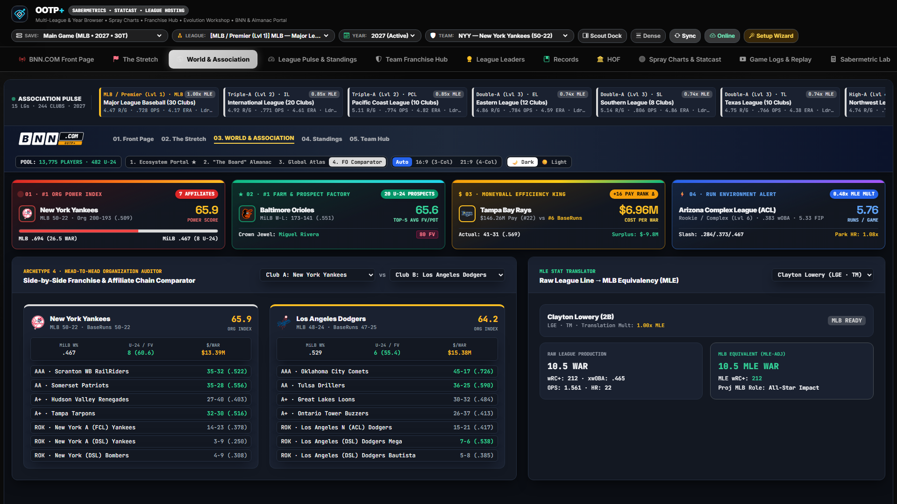

# World & Association Ecosystem Dashboard

[← Previous: "The Stretch" Pennant Hub](./03-the-stretch-pennant-hub.md) • [Documentation Index](./README.md) • [Next: League Pulse & Standings →](./05-league-pulse-and-standings.md)

---

Out of the Park Baseball saves often span far more than a single major league—incorporating 5+ minor-league affiliate levels (`AAA`, `AA`, `A+`, `A`, `ROK`), international top-flight leagues, winter leagues, and independent circuits.

The **World & Association Dashboard** (`world`) provides a macro-level intelligence center across **every league, organization, player pool, and nation** in your entire `.lg` universe.

---

## 1. World Portal, Organizational Pyramid & Macro Quadrants

### Key Sections & Analytical Tools

- **Universe KPI Strip & 4-Archetype Bar:**
  - Summarizes total active leagues, competition tiers, total rostered/free-agent/retired/HOF players, U24 prospects, `60+ OA` superstars, global payroll obligations, global attendance, and historical year span.
  - Spotlights the save's top **Dynasty Juggernaut**, **Moneyball Efficiency Leader**, **No. 1 Farm Pipeline**, and **Pound-for-Pound World MVP**.
- **All-Leagues Ecosystem Matrix:**
  - Compares every league in your save side-by-side: Competition Level (`Lvl 1` Premier through Rookie/Indy), Team & Player counts, League Slash Line (`AVG / OBP / SLG`), League `ERA` and `R/G`, **Competitive Parity Index (`0–100`)**, Average `OA / POT / Age`, current standings leader, reigning champion, and top `WAR` player.
  - Click any league row to jump directly into that league's standings or pennant race.
- **Organizational Pyramid & Affiliate Power Index (`0–100`):**
  - Evaluates all parent franchises from top to bottom—combining Major League winning percentage, minor-league affiliate performance (`AAA`, `AA`, `A+`, `A`, `ROK`), U24 prospect depth, Future Value (`FV`) farm ceiling, and championships into a single **Organizational Power Index**.
  - Filterable via instant organization search, with clickable rows to inspect full affiliate trees.
- **Interactive Macro Visualizers (3 Modes):**
  1. **Financial Efficiency Quadrant:** Plots payroll vs. win percentage across four club archetypes—**Juggernaut** (High Payroll / High Win%), **Moneyball Contender** (Low Payroll / High Win%), **Underachiever** (High Payroll / Low Win%), and **Rebuilding** (Low Payroll / Low Win%).
  2. **World Talent & Age Distribution:** Toggle between **Scouting Talent Tiers (`80` Grade Elite down to `<40` Depth)** and **Player Age Pyramids**.
  3. **25-Year Historical Run Environment:** Tracks multi-decade offensive (`R/G`, `OPS`) and pitching (`ERA`, `K/9`) eras across your save's history.
- **MLE Pound-for-Pound Leaderboard & Translator:**
  - Toggle between **MLE (Major League Equivalency)** and **Raw Stats** across **Batters**, **Pitchers**, and **Prospects** to compare stars from international or minor-league tiers on a level playing field with premier-league superstars.
- **Top 12 International Talent Pipelines:**
  - Ranks baseball-producing nations (`nations.csv`) by active players, `60+ OA` stars, total `WAR` produced, and top national ambassador.

---

## 2. Multi-View World Modes: Almanac, Atlas & Org Comparator

Use the view switcher in the World scorebug header to pivot across four specialized perspectives:

- **Portal View:** Full macro dashboard combining ecosystem tables, quadrant charts, MLE rankings, and org pyramids.
- **World Almanac View:** Multi-season championship ledger, dynasty leaderboard, and historical era records across every league in your save.
- **Global Baseball Atlas:** Geographic and national distribution breakdown of player origins, baseball quality tiers, and international talent pipelines.
- **Head-to-Head Organization Comparator:** Select any **Organization A** and **Organization B** to compare MLB rosters, payroll efficiency, affiliate winning percentages at every minor-league rung, Future Value (`FV`) prospect tiers, and 5-year organizational trajectory side-by-side.

---

[← Previous: "The Stretch" Pennant Hub](./03-the-stretch-pennant-hub.md) • [Documentation Index](./README.md) • [Next: League Pulse & Standings →](./05-league-pulse-and-standings.md)
