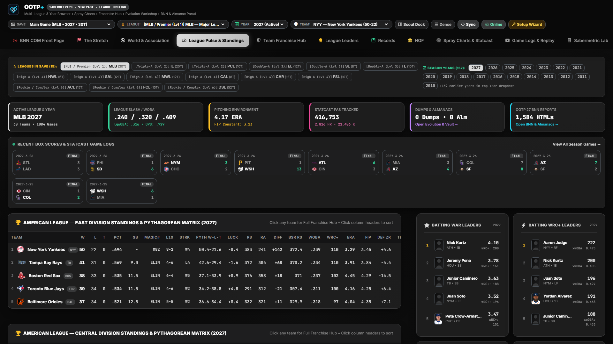

# League Pulse, Pythagorean Standings & Run Environment

[← Previous: World & Association](./04-world-and-association.md) • [Documentation Index](./README.md) • [Next: Team Franchise Hub →](./06-team-franchise-hub.md)

---

**League Pulse & Standings** (`overview`) serves as your active league's statistical control room—combining macro run-environment telemetry, recent box scores, Pythagorean & BaseRuns standings matrices, and instant `WAR` / `wRC+` / `FIP` leaderboards.

---

## Key Screen Components & Functions

### 1. Season Year Quick-Switcher Strip
- Displays pill buttons for every available season year ingested from your save's career tables, yearly dumps, and historical almanacs.
- Click any year pill (e.g., `2049`, `2048`, `2047`) to immediately recalculate the entire standings matrix, run-environment constants, and leaderboards for that historical campaign.

### 2. League Run-Environment & Data Telemetry Cards
Because OOTP saves range from 19th-century deadball replays to high-offense fictional leagues, OOTP+ never hardcodes modern MLB constants. Instead, five live telemetry cards report the exact mathematical baseline used across the suite for the selected league-year:

| Telemetry Card | What It Measures |
| :--- | :--- |
| **Active League & Year** | League name, active year, team count, total completed games, and tie support (`W-L-T`). |
| **League Slash / wOBA** | League-wide `AVG / OBP / SLG`, calibrated `lgwOBA`, and `lgOPS` baseline used to scale `wRC+` and `OPS+` (`100` = league average). |
| **Pitching Environment** | League `ERA` and dynamically computed **FIP Constant** (`cFIP = lgERA - (((13*lgHR) + (3*(lgBB+lgHBP)) - (2*lgK)) / lgIP)`), ensuring `FIP` and `xFIP` sit on the exact same scale as your league's `ERA`. |
| **Statcast PAs Tracked** | Total plate appearances / batted-ball records ingested into SQLite, plus league-wide `HR` and `K` totals. |
| **Dumps, Almanacs & BNN Vault** | Total archived chronological CSV dumps (`dump_YYYY_MM`), historical almanacs, and native BNN HTML reports discovered on disk, with one-click shortcuts to the **Evolution Data Vault** and **BNN Portal**. |

### 3. Recent Box Scores & Statcast Game Strip
- Displays a grid of the latest completed games across the league with team logos, final scores, and winning sides highlighted.
- Click any box score card—or **View All Season Games →**—to jump straight into that game's box score and pitch-by-pitch / at-bat play-by-play inside the **Game Logs & Replay Center**.

### 4. Standings & Pythagorean / BaseRuns Matrix
- Supports both division-grouped and full-league sortable views, automatically detecting leagues that allow ties (`W-L-T`).
- **True-Talent & Luck Columns:**
  - `PYTH W-L`: Expected record computed via the dynamic Pythagenpat exponent (`((RS + RA) / G) ^ 0.287`).
  - `LUCK`: Actual wins minus Pythagorean expected wins (`+5.3` overperforming vs. `-7.1` unlucky).
  - `BSR RS`: BaseRuns expected runs scored based on underlying offensive components rather than sequencing luck.
  - **Team Sabermetric Pillars:** Displays team `wOBA`, `wRC+`, `ERA`, `FIP`, and defensive Zone Rating (`DEF ZR`) side-by-side on a single row.
- **One-Click Franchise Drill-Down:** Click any team row in the standings table to switch your active team perspective and open that club's **Team Franchise Hub**.

### 5. Live Process & Value Leader Cards
- Four right-hand leader cards surface the league's top 5 **Batting WAR**, **Batting wRC+**, **Pitching WAR**, and **Pitching FIP** performers with player headshots, secondary process stats (`xwOBA`, `ERA+`), and one-click access to each player's **Analytical Dossier**.

---

[← Previous: World & Association](./04-world-and-association.md) • [Documentation Index](./README.md) • [Next: Team Franchise Hub →](./06-team-franchise-hub.md)
