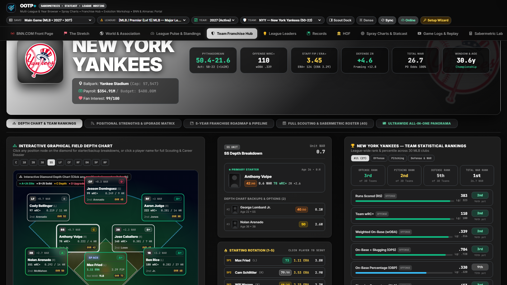
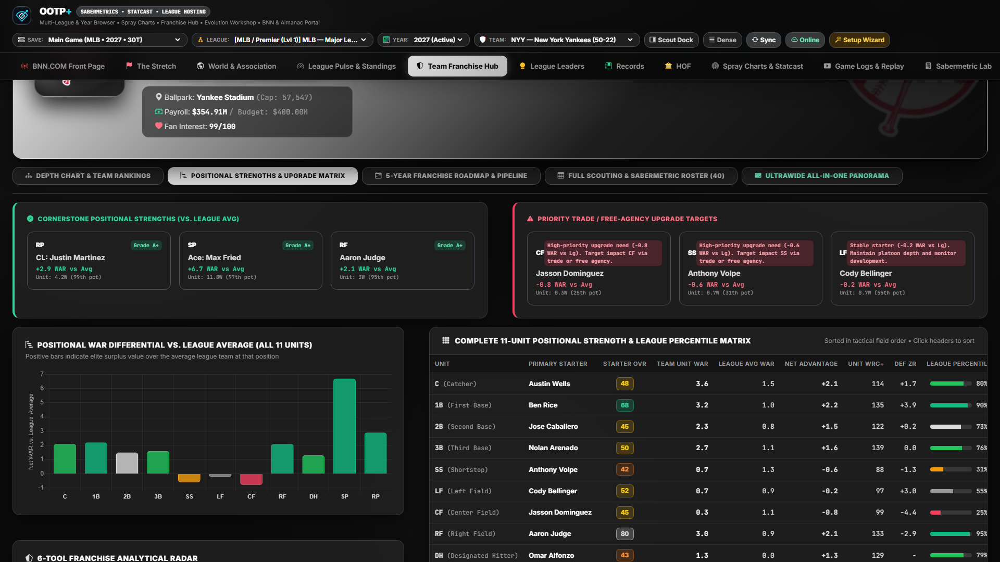
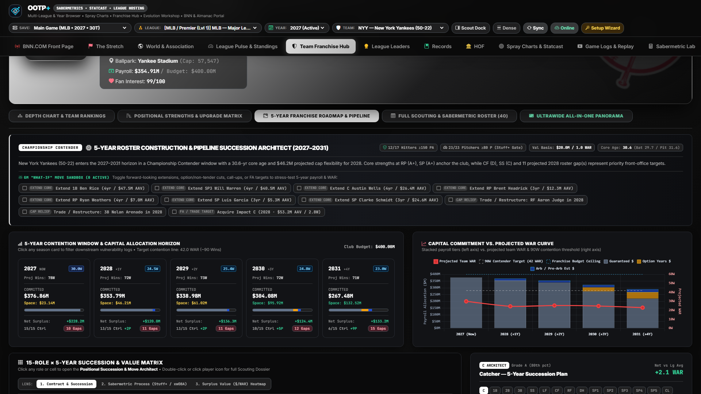

# Team Franchise Hub, 27-Metric Rankings & 5-Year Roadmap

[← Previous: League Pulse & Standings](./05-league-pulse-and-standings.md) • [Documentation Index](./README.md) • [Next: Leaders, Records & Hall of Fame →](./07-leaders-records-and-hof.md)

---

The **Team Franchise Hub** (`teamhub`) is OOTP+'s general-manager war room for any Major League, Minor League (`AAA` through `ROK`), or International club in your save. Switch teams anytime via the **Team** dropdown in the top Command Bar (or by clicking any team in the standings) to inspect its roster, depth chart, league rankings, and 5-year succession plan.

---

## 1. Interactive Diamond Depth Chart & Unit Grades

- **Executive Franchise Banner:** Displays club logo, record, Pythagorean record, division rank, active payroll, fan interest, ballpark factors, and minor-league affiliate badges.
- **Interactive On-Field Baseball Diamond:**
  - Maps the active starter and top 2 organizational backups across every defensive position (`C`, `1B`, `2B`, `3B`, `SS`, `LF`, `CF`, `RF`, `DH`), alongside the **5-Man Starting Rotation (`SP1–SP5`)** and **Bullpen Corps (`CL`, `SU`, `MR`)**.
  - **Unit Letter Grades (`A+` to `D`) & League Percentiles:** Evaluates every positional group against league peers using blended `WAR`, `wRC+` / `FIP`, defensive `ZR`, and `20–80` current/potential scouting grades.
  - Click any position node on the diamond to inspect full depth comparisons, handedness splits, and internal minor-league call-up options at that spot.

---

## 2. Positional Strengths, Upgrade Matrix & 27-Metric League Rankings

Switch to the **Positional Strengths & League Rankings** sub-tab to diagnose exactly where your roster gains or loses wins relative to the rest of the league:

- **Positional WAR vs. League Average Chart:** Bar-by-bar breakdown showing net positional advantage or deficit at every lineup spot, rotation tier, and bullpen role.
- **Top 3 Positional Cornerstones & Top 3 Priority Upgrade Targets:** Automatically identifies your club's strongest foundation units and biggest roster leaks, paired with actionable front-office recommendations.
- **27-Metric League-Wide Team Statistical Rankings (`#1` to `#N`):**
  - Ranks your club across **27 core statistical categories** organized into three pillars (filterable by `All`, `Offense`, `Pitching`, or `Defense & Value`):
    1. **Offense (10 Metrics):** `Runs Scored`, `AVG`, `OBP`, `SLG`, `OPS`, `wOBA`, `wRC+`, `HR`, `SB`, `BB% / K%`.
    2. **Pitching (10 Metrics):** `Runs Allowed`, `ERA`, `FIP`, `xFIP`, `ERA+`, `WHIP`, `K/9`, `BB/9`, `HR/9`, `Saves`.
    3. **Defense & Club Value (7 Metrics):** `Team WAR`, `Batting WAR`, `Pitching WAR`, `Defensive ZR`, `Catcher Framing`, `Defensive Efficiency (DER)`, `Payroll Efficiency ($/WAR)`.
  - Every card displays your exact league rank (`#1`–`#30`), raw value, league average baseline, and color-coded percentile bar.

---

## 3. 5-Year Franchise Roadmap, Succession Grid & Gap Engine

Built for multi-season roster planning, the **5-Year Franchise Roadmap** projects how your roster will evolve over the next five campaigns (`Year 0` through `Year +4`):

- **5-Year Projected Starters & Positional Succession Grid (15 Roles × 5 Seasons):**
  - Projects the primary starter at all **9 lineup positions + `SP1..SP5` + `CL`** across five seasons by modeling contract expiration, arbitration control, age-curve progression/regression, and minor-league prospect ETAs.
  - Filterable by unit (`All Roles`, `Infield`, `Outfield`, `Rotation & Bullpen`) and analytical lens (`Projected OA/POT`, `Contract Status`, `Age Curve`).
- **Automated Positional Gap & Front-Office Action Plan:**
  - Flags impending roster holes caused by **UFA Departures**, **Veteran Age Decline (`34+`)**, **Sub-Replacement Incumbents (`<45 OA`)**, or **Thin Farm Depth**.
  - Pairs every flagged hole with either an internal **Pipeline Call-Up** candidate (with projected ETA and scouting grade) or an external **Free Agency / Trade Target** directive—plus interactive sandbox checkboxes so you can check off resolved offseason priorities.
- **5-Year Contract & Age-Curve Matrix:**
  - Color-coded multi-year obligation ledger (`Guaranteed`, `Team Option`, `Player Option`, `Pre-Arb`, `Arb Estimate`, `UFA`) paired with age-curve tags (`Ascending Core 📈`, `Prime Window 🔥`, `Veteran Pillar ⚖️`, `Decline Watch ⚠️`) and a **5-Year Committed Payroll vs. Budget Horizon** chart.
- **Organizational Prospect & Young Core Pipeline:**
  - Tracks top U25 prospects across all minor-league affiliates (`AAA`, `AA`, `A+`, `A`, `ROK`) with `OA / POT` bars, current level, ETA year, and projected MLB role.

---

[← Previous: League Pulse & Standings](./05-league-pulse-and-standings.md) • [Documentation Index](./README.md) • [Next: Leaders, Records & Hall of Fame →](./07-leaders-records-and-hof.md)
