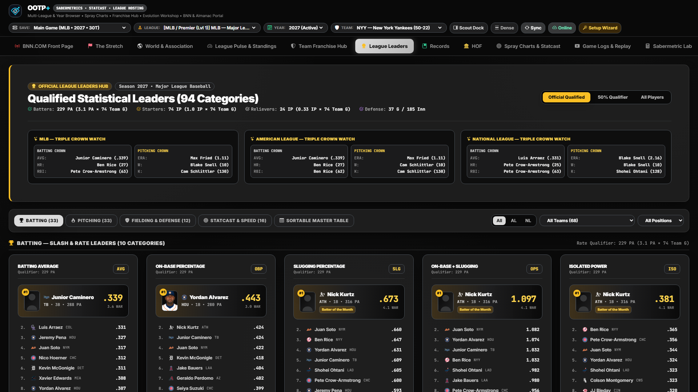
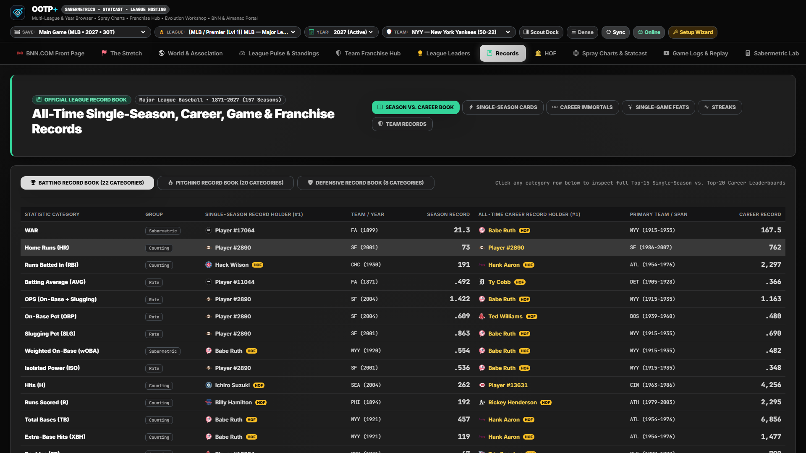
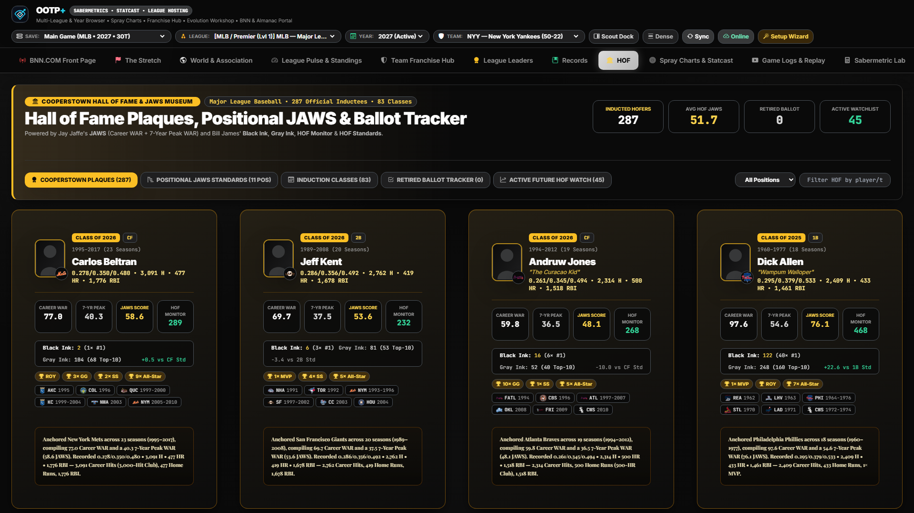

# League Leaders, Records Book & Cooperstown Hall of Fame (JAWS)

[← Previous: Team Franchise Hub](./06-team-franchise-hub.md) • [Documentation Index](./README.md) • [Next: Spray Charts, Statcast & Game Replay →](./08-statcast-and-game-replay.md)

---

**OOTP+** celebrates both active seasonal excellence and multi-decade historical legacy across three dedicated museum-grade hubs: **League Leaders** (`leaders`), **Records Book** (`records`), and **Cooperstown Hall of Fame & JAWS** (`hof`).

---

## 1. League Leaders Hub (`leaders`)

A Baseball-Reference & MLB.com style leaderboard gallery featuring top-10 visual leader cards with player portraits, team badges, and full sortable tables.

### Key Controls & Categories
- **5 Domain Tabs:**
  1. **Batting Cards:** `WAR`, `wRC+`, `wOBA`, `OPS`, `AVG`, `OBP`, `SLG`, `HR`, `RBI`, `SB`, `H`, `BB`.
  2. **Pitching Cards:** `WAR`, `ERA`, `ERA+`, `FIP`, `xFIP`, `WHIP`, `K`, `W`, `SV`, `IP`, `K/9`, `K-BB%`.
  3. **Fielding Cards:** `Zone Rating (ZR)`, `Catcher Framing`, `Defensive Efficiency`, `FLD%`, `Assists`, `Double Plays`.
  4. **Statcast Cards:** `Avg Exit Velocity`, `Max Exit Velocity`, `Barrel %`, `Hard-Hit %`, `xwOBA`, `Sweet-Spot %`.
  5. **Full Sortable Leaderboard Table:** Complete tabular view across Batting, Pitching, or Fielding.
- **Dynamic Qualifier & Roster Filters:**
  - Switch playing-time thresholds between **Qualified (`3.1 PA/G` • `1.0 IP/G`)**, **50% Threshold**, and **All Players (No Minimum)**.
  - Filter simultaneously by **Sub-League**, **Team**, **Defensive Position**, or **Pitcher Role (`ALL`, `SP`, `RP`)**.

---

## 2. League Records Book (`records`)

Reconstructs your save's complete record book across every archived season, career stat ledger, and box score log:

- **Side-by-Side Single-Season vs. All-Time Career Records:** View single-season record holders alongside all-time career kings across Batting (`HR`, `AVG`, `H`, `RBI`, `R`, `SB`, `BB`, `WAR`, `OPS`), Pitching (`W`, `K`, `ERA`, `SV`, `IP`, `SHO`, `WHIP`, `WAR`), and Fielding.
- **Single-Game Feats & Milestones:** Surfaces historic single-game explosions (multi-HR games, high-strikeout gems, no-hitters, and high-RBI performances).
- **All-Time Streaks & Team Franchise Records:** Tracks longest hitting streaks, scoreless streaks, and single-season franchise win/offense/pitching benchmarks.

---

## 3. Cooperstown Hall of Fame & JAWS Museum (`hof`)

Modeled on Jay Jaffe's **JAWS (Jaffe WAR Score System)** and Bill James's Cooperstown metrics, the Hall of Fame hub evaluates both inducted immortals and active veterans building Hall of Fame cases.

### Sub-Views & Analytical Metrics
- **Inducted Plaques Gallery (`plaques`):**
  - Bronze-and-gold museum plaques for every inducted Hall of Famer in your save, displaying primary cap logo, career span, induction year, `Career WAR`, `7-Year Peak WAR`, and `JAWS`.
- **Positional JAWS Standards (`jaws_pos`):**
  - Compares players against the historical Cooperstown benchmark at their primary position (`C`, `1B`, `2B`, `3B`, `SS`, `LF`, `CF`, `RF`, `SP`, `RP`), where:
    - `JAWS = (Career WAR + Best 7-Year Peak WAR) / 2`
- **Induction Classes (`classes`):** Chronological breakdown of every Hall of Fame induction class by year.
- **Projected Ballot (`ballot`) & Active Watchlist (`active_watch`):**
  - Evaluates recently retired legends and active veterans on a Cooperstown trajectory using four classic Hall of Fame gauges:
    - **JAWS Index %** (percentage of positional JAWS standard achieved)
    - **Black Ink** (league-leading seasons weighted by category importance)
    - **Gray Ink** (top-10 league finishes)
    - **HOF Monitor & HOF Standards** (`100+` indicates a likely Hall of Famer)

---

[← Previous: Team Franchise Hub](./06-team-franchise-hub.md) • [Documentation Index](./README.md) • [Next: Spray Charts, Statcast & Game Replay →](./08-statcast-and-game-replay.md)
