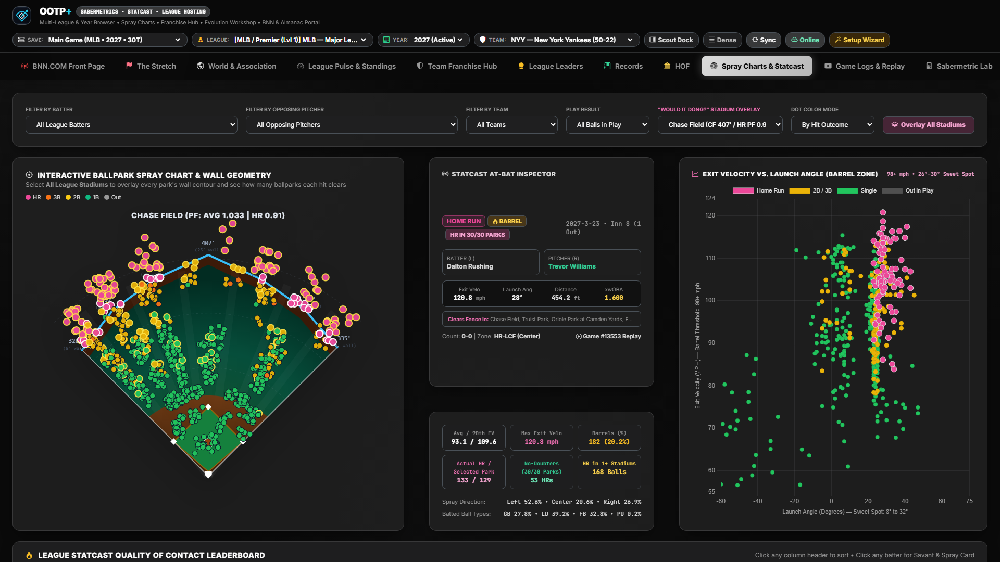
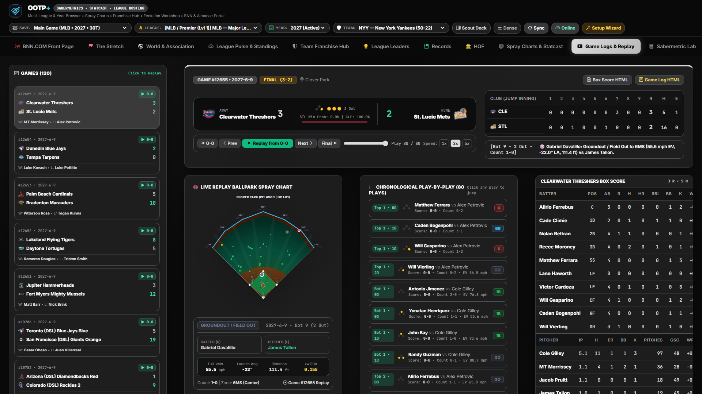

# Spray Charts, 3D Statcast Visualizer & Game Logs Replay Center

[← Previous: Leaders, Records & Hall of Fame](./07-leaders-records-and-hof.md) • [Documentation Index](./README.md) • [Next: Sabermetric Lab & Projections →](./09-sabermetric-lab-and-projections.md)

---

**OOTP+** translates raw OOTP plate-appearance and game event tables into visual ballpark geometry and interactive pitch-by-pitch / at-bat game replays across **Spray Charts & Statcast** (`statcast`) and **Game Logs & Replay** (`gamelogs`).

---

## 1. Spray Charts & 3D Statcast Visualizer (`statcast`)

### How OOTP+ Computes Ballpark Coordinates
OOTP exports plate-appearance outcomes (`players_at_bat_batting_stats.csv`) containing hit location zones (`hit_loc` / OOTP fielding zone codes like `7LD`, `8XD`, `9LS`, `6MD`), batted-ball types, and outcome codes. OOTP+'s coordinate engine (`map_hit_to_spray_coords` in `app/config.py` and `app/analytics.py`) projects every batted ball into:
- **Spray Angle (`angle_deg`):** `-45°` (Left-Field Foul Line) through `0°` (Dead Center) to `+45°` (Right-Field Foul Line).
- **Flight Distance (`distance_ft`):** Scaled dynamically against the active ballpark's real fence dimensions (`distances0` Left Line through `distances4` Right Line from `parks.csv`).
- **Statcast Quality-of-Contact Telemetry:** Exit Velocity (`mph`), Launch Angle (`deg`), Barrel classification, Hard-Hit rate (`95+ mph`), and expected weighted on-base average (`xwOBA`).

### Interactive Filters & Visual Panels
- **Multi-Dimensional Filter Bar & `"Would It Dong?"` Stadium Overlay:**
  - Filter batted balls by **Batter**, **Opposing Pitcher**, **Team**, **Play Result** (`All Balls in Play`, `Home Runs`, `Extra-Base Hits`, `Hits`, `Outs`, `Barrels`), **Ballpark Wall Overlay**, and **Dot Color Mode**.
  - Click **`Overlay All Stadiums`** to superimpose every ballpark's outfield wall contour simultaneously and check how many stadiums (`HR in 30/30 Parks` No-Doubters vs. `HR in 1+ Stadiums`) each fly ball clears!
- **SVG Stadium Spray Canvas & Statcast At-Bat Inspector:**
  - Color-coded batted-ball markers plotted over scaled wall heights and distances (`330'`, `407'`, `335'`).
  - Click any batted ball on the field to load it into the center **Statcast At-Bat Inspector**, displaying exact Exit Velocity (`120.8 mph`), Launch Angle (`28°`), Distance (`454.2 ft`), `xwOBA` (`1.600`), count, zone code (`HR-LCF`), every stadium whose fence it clears, and a one-click jump to that game's Play-by-Play Replay.
- **Exit Velocity vs. Launch Angle (`Barrel Zone`) Scatter & Quality-of-Contact Leaderboard:**
  - Right-hand scatter chart highlighting the `98+ mph` / `26°–30°` Sweet-Spot Barrel Zone alongside a sortable league-wide Statcast Quality-of-Contact Leaderboard below.

---

## 2. Game Logs & Play-by-Play Replay Center (`gamelogs`)

Browse every completed game in your active season, audit full box scores, or relive dramatic finishes step-by-step.

### Key Features
- **Season Scoreboard Sidebar & Team Filter:**
  - Filter the game list to a specific franchise or browse league-wide results chronologically, showing dates, matchups, final scores, and attendance.
- **Broadcast Line Score & Dual Box Scores:**
  - Full inning-by-inning `R / H / E` line score header with winning pitcher, losing pitcher, save, ballpark attendance, weather/park factors, and complete **Batting** (`AB`, `R`, `H`, `RBI`, `BB`, `K`, `HR`, `WPA`) and **Pitching** (`IP`, `H`, `R`, `ER`, `BB`, `K`, `HR`, `ERA`) box scores for both clubs.
- **Interactive At-Bat Replay Player:**
  - Click **Play / Pause**, step forward/backward one plate appearance at a time, scrub to any inning, or adjust playback cadence (`0.5x`, `1x`, `2x`).
  - Displays a live **Base-Out Diamond SVG** (highlighting occupied bases `1B / 2B / 3B`, outs indicator, inning half, live scorebug, current batter vs. pitcher matchup, and play-by-play call).
- **In-Game Ballpark Spray Overlay:**
  - Plots every batted ball from the selected game directly onto the home stadium's outfield diagram so you can visualize exactly where key rallies and home runs landed.

---

[← Previous: Leaders, Records & Hall of Fame](./07-leaders-records-and-hof.md) • [Documentation Index](./README.md) • [Next: Sabermetric Lab & Projections →](./09-sabermetric-lab-and-projections.md)
