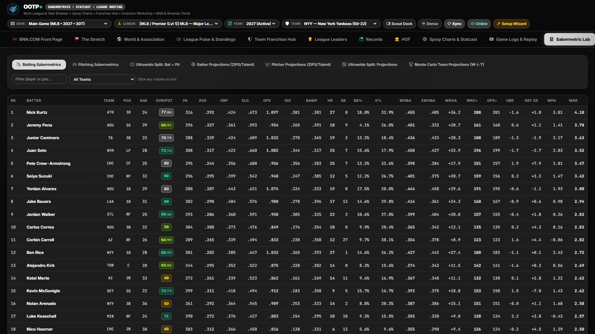

# Sabermetric Lab & Hybrid True-Talent Projections

[← Previous: Spray Charts, Statcast & Game Replay](./08-statcast-and-game-replay.md) • [Documentation Index](./README.md) • [Next: League Evolution & Expansion →](./10-league-evolution-and-expansion.md)

---

The **Sabermetric Lab** (`sabermetrics`) is OOTP+'s full-bleed quantitative research workbench—combining FanGraphs-grade advanced leaderboards, Statcast expected-outcome scatter plots, handedness splits, and ZiPS-style hybrid true-talent projections.

---

## 1. Dynamic League-Calibrated Sabermetric Engine

Every metric in the Sabermetric Lab is dynamically calibrated to the active league and season year (`app/analytics.py`), ensuring 100% mathematical accuracy across historical eras, modern MLB saves, and custom fictional universes:

### Batting Metrics Computed
- **Rate & Slash:** `PA`, `AB`, `AVG`, `OBP`, `SLG`, `OPS`, `ISO` (`SLG - AVG`), `BABIP`, `BB%`, `K%`, `BB/K`.
- **Linear Weights & Context-Neutral Offense:**
  - `wOBA` (Weighted On-Base Average) & `xwOBA` (Statcast quality-of-contact expected wOBA).
  - `wOBA - xwOBA` Luck Differential (identifies hitters outperforming or underperforming their batted-ball quality).
  - `wRAA` (Weighted Runs Above Average), `wRC` (Weighted Runs Created), `wRC+` (`100` = league average), and `OPS+`.
- **Total Value:** Baserunning (`BsR` / `wSB`), Defensive Zone Rating (`ZR`), Positional Adjustment, and total **Batting `WAR`**.

### Pitching Metrics Computed
- **Run Prevention:** `IP`, `W-L`, `SV`, `ERA`, `ERA+` (`100` = league average), `ERA-`, `WHIP`, `BABIP`.
- **Defense-Independent Pitching:**
  - `FIP` (Fielding Independent Pitching using the league-year's exact `cFIP` constant).
  - `xFIP` (normalizing home-run rate to league-average HR/FB tendency).
  - `ERA - FIP` Differential (identifies pitchers benefiting from elite defense/strand luck vs. pitchers suffering bad BABIP luck).
- **Command & Dominance:** `K/9`, `BB/9`, `HR/9`, `K%`, `BB%`, `K-BB%`, and total **Pitching `WAR`**.

---

## 2. Interactive Controls, Splits & Quadrant Scatters

- **Sub-View Workbench Tabs:**
  - **Batting Sabermetrics** (`batting`)
  - **Pitching Sabermetrics** (`pitching`)
  - **Ultrawide Split View** (`split_saber`) — Renders Batting and Pitching sabermetric tables side-by-side simultaneously on `1800px+` ultrawide displays.
  - **Batter Projections** (`proj_batters`), **Pitcher Projections** (`proj_pitchers`), and **Ultrawide Split Projections** (`split_proj`).
- **Granular Filtering & Qualifier Controls:**
  - Instant **Player Search**, **Team Filter**, **Position Filter**, **Minimum `PA` / `IP` Threshold**, and **Handedness Split Selector** (`Overall`, `vs LHP`, `vs RHP`).
- **Interactive Quadrant Scatter Plots:**
  - Visualizes `wOBA vs. xwOBA` (Batting Process vs. Results), `ERA vs. FIP` (Pitching Run Prevention vs. Fielding-Independent Skill), and `K% vs. BB%` discipline quadrants with hoverable player nodes.

---

## 3. Hybrid True-Talent Projections (`GET /api/projections`)

Unlike simple historical averages, OOTP+'s projection engine blends three predictive signals for every hitter and pitcher:
1. **Multi-Year Weighted Statistical Performance** (regressed toward league mean by sample size `PA` / `IP`).
2. **Current & Potential `20–80` Scouting Tools** (`Contact`, `Power`, `Eye`, `Avoid K`, `Stuff`, `Movement`, `Control`) translated into expected component rates.
3. **Age-Curve Progression / Regression Modifiers** (modeling U25 development upside vs. `32+` veteran aging curves).

---

[← Previous: Spray Charts, Statcast & Game Replay](./08-statcast-and-game-replay.md) • [Documentation Index](./README.md) • [Next: League Evolution & Expansion →](./10-league-evolution-and-expansion.md)
