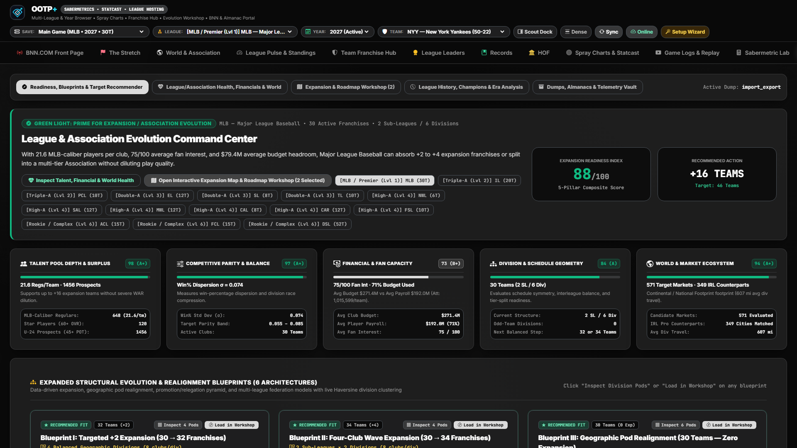
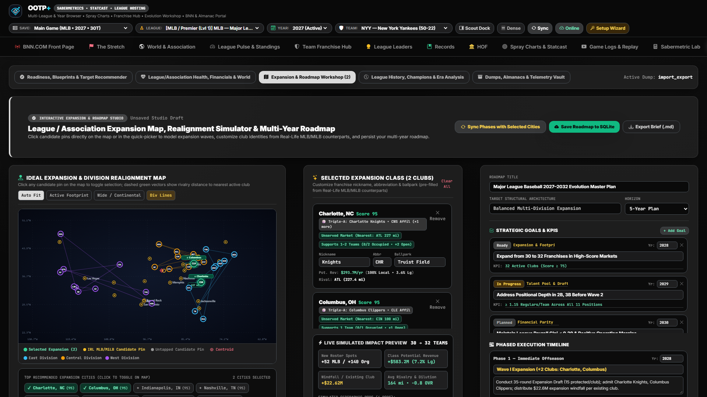

# League Evolution, Market Economics & Expansion Roadmap Workshop

[← Previous: Sabermetric Lab & Projections](./09-sabermetric-lab-and-projections.md) • [Documentation Index](./README.md) • [Next: StatsPlus & Trade Machine →](./11-statsplus-and-trade-machine.md)

---

Long-running OOTP worlds thrive on expansion, relocation, and divisional realignment. The **League Evolution & Expansion Hub** (`evolution`) combines geospatial market modeling, Metropolitan Statistical Area (MSA) economics, competitive talent-pool diagnostics, and an interactive **Expansion Roadmap Workshop** (`app/evolution_engine.py`, `app/irl_counterparts.py`).

---

## 1. Expansion Readiness & Candidate Market Economics (`readiness`)

### Composite Expansion Readiness Index (`0–100`)
Evaluates whether your active league is structurally healthy enough to expand right now across multi-pillar diagnostics (talent dilution depth, competitive parity, financial stability, minor-league pipeline supply, and structural division symmetry) and recommends optimal structural blueprints (e.g., `30 → 32 Teams` across `2 Sub-Leagues × 4 Divisions of 4`).

### Geospatial MSA Market Matrix & Revenue Modeling
Cross-references OOTP's `cities.csv` with a curated registry of real-life MLB, Triple-A, Double-A, High-A, Single-A, Independent, and International markets plus normalized MSA populations (`METRO_MSA_REFERENCE_POPS`) and metro cluster aliases (`METRO_ALIASES`, such as NYC/Brooklyn/Newark, LA/Anaheim, DFW, Bay Area, Chicagoland, and Tampa/St. Pete):

- **Market Service Classification:** Identifies whether each candidate city is **Unserved (Greenfield)**, **Regionally Served (`<75 mi`)**, **Metro Shared**, or **In-City Shared**, listing any active in-save major or minor league clubs nearby.
- **Multi-Club Market Capacity:** Models total **Supported Teams Capacity** (`1 Team`, `1–2 Teams`, `2 Teams`, `2–3 Teams`) and flags remaining slot availability (`Open`, `Addl. Slot`, `At Capacity`, `Oversaturated`).
- **Projected Annual Club Revenue & Market Share:**
  - Models **Potential Club Revenue** broken into **Gate Receipts (40%)**, **Local Media Rights (42%)**, and **Merchandise & Licensing (18%)**.
  - Reports **Total Metro Revenue Pool**, **Local Market Share %**, and **League Revenue Share %**, with customizable weighting sliders so you can prioritize Market Size, Geographic Travel Fit, or Baseball Heritage.

---

## 2. Interactive SVG Expansion Map & Multi-Phase Roadmap Workshop (`workshop`)

Click **Open Interactive Expansion Map & Roadmap Workshop** to design, preview, and persist your league's future:

- **Clickable SVG Geographic Map:**
  - Visualizes all incumbent franchises alongside top candidate expansion pins. Click any city pin on the map (or row in the market selector) to add or remove expansion franchises.
- **Custom Franchise Identity & Phase Builder:**
  - Assign custom team nicknames, 3-letter abbreviations, target expansion years, and multi-phase expansion waves (`Phase 1`, `Phase 2`, etc.).
- **Haversine Travel-Optimized Divisional Realignment:**
  - Automatically computes optimal sub-league and division groupings that minimize total intra-division Haversine air-travel mileage while preserving historic rivalries.
- **Persistent Roadmap Storage (`GET` / `POST /api/evolution/roadmap`):**
  - Save and reload custom multi-phase expansion blueprints directly inside `data/ootp_host.db`.

---

## 3. Additional Evolution Sub-Views (`health`, `history`, `vault`)

- **League & World Health Diagnostics (`health`):** Audits league-wide pitching/hitting talent depth, payroll disparity Gini metrics, and age/replacement-level dilution risks prior to adding expansion draft slots.
- **Franchise Lineage & League History (`history`):** Tracks historical league size changes, championship eras, and franchise records.
- **Chronological Dump & Almanac Data Vault (`vault`):** Inspects all discovered `dump_YYYY_MM` / `dump_YYYY_yearly` CSV snapshots and `almanac_YYYY` archives on disk, allowing one-click time-travel ingestion.

---

[← Previous: Sabermetric Lab & Projections](./09-sabermetric-lab-and-projections.md) • [Documentation Index](./README.md) • [Next: StatsPlus & Trade Machine →](./11-statsplus-and-trade-machine.md)
