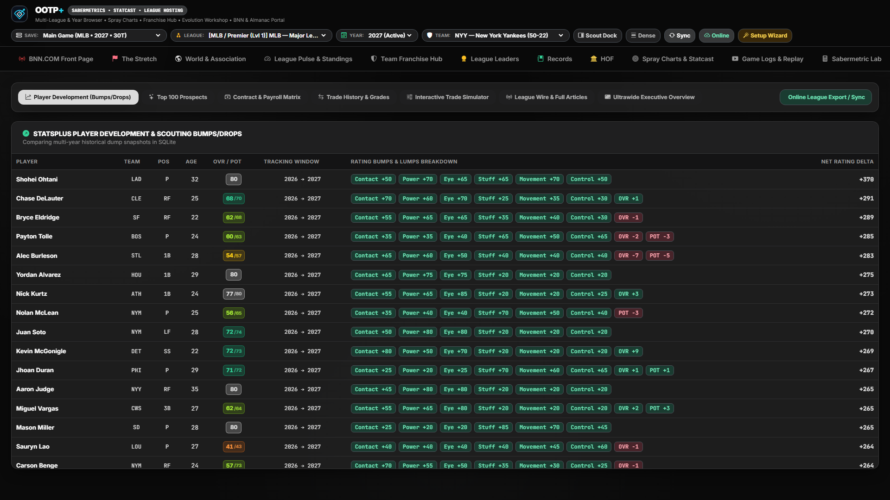
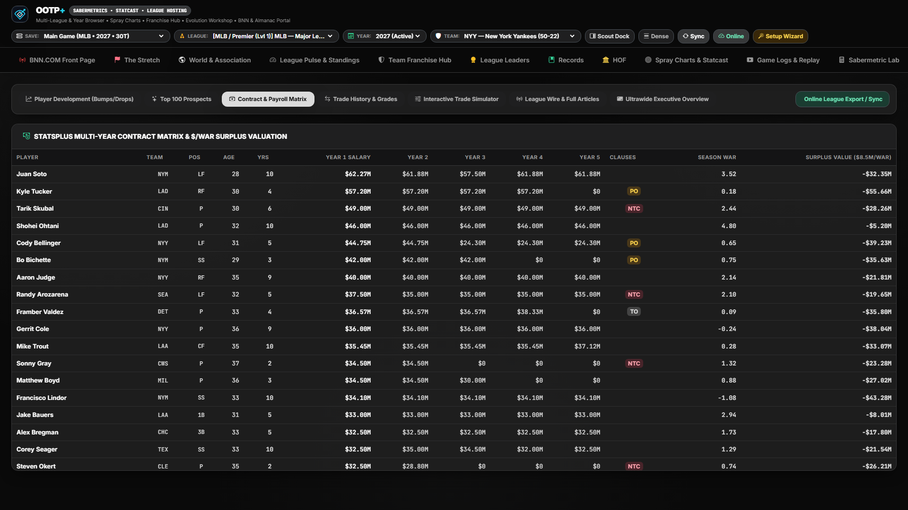
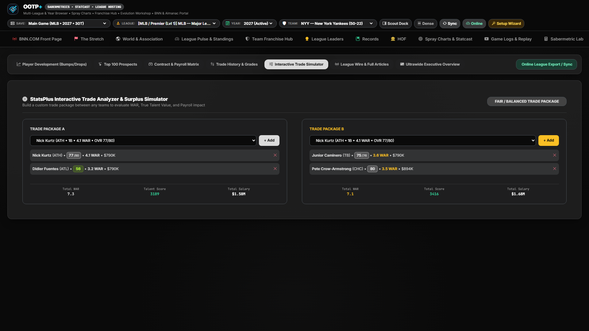

# StatsPlus Portal, Development Tracker & Interactive Trade Machine

[← Previous: League Evolution & Expansion](./10-league-evolution-and-expansion.md) • [Documentation Index](./README.md) • [Next: OOTP HTML & BNN Almanacs →](./12-bnn-html-and-almanacs.md)

---

Inspired by online league commissioner portals and modern front-office scouting systems, the **StatsPlus & Trade Hub** (`statsplus`) brings longitudinal player rating tracking, farm system rankings, multi-year contract efficiency, and an interactive trade simulator together under one roof.

---

## 1. Multi-Dump Player Development Tracker (`dev`)

Whenever OOTP exports chronological snapshots (`dump_YYYY_MM`, `dump_YYYY_yearly`, and `import_export/csv`), OOTP+'s ingestion engine compiles longitudinal rating tables (`dump_player_rating_snapshots`) across time:

- **Biggest Risers & Fallers:** Automatically surfaces players experiencing scouting breakouts or regressions in Overall (`OA`), Potential (`POT`), Batting tools (`CON`, `POW`, `EYE`), and Pitching tools (`STU`, `MOV`, `CTL`).
- **Component Delta Badges:** Shows exact `+5` / `+10` / `-5` scouting grade changes between snapshots alongside age, affiliate level, and current on-field `WAR` / `wRC+` / `FIP`.

---

## 2. Top 100 Prospects & Organizational Farm Rankings (`prospects`)

- **Top 100 Prospects Board:** Ranks the premier U25 minor-league prospects across your entire association using Future Value (`FV`), `POT` ceiling, current tool floor, age-relative-to-level dominance, and positional scarcity.
- **30-Team Farm System Leaderboard:** Grades every parent organization's minor-league pipeline by total prospect surplus value, Top-100 representation, elite `65+ POT` blue-chip count, and depth.

---

## 3. Contract & Payroll Efficiency Matrix (`contracts`)

- **Multi-Year Club Payroll Obligations:** Audits guaranteed salaries, team/player options, arbitration estimates, and expiring deals across upcoming seasons.
- **`$/WAR` Surplus Value Grading:** Compares each player's annual salary against the open-market dollar value of their on-field `WAR` production to spotlight bargain extensions, albatross contracts, and impending free-agent targets.

---

## 4. Interactive Multi-Player Trade Machine (`trade_machine`) & Trade Wire (`trades`)

- **Live Two-Team Trade Simulator:**
  - Select **Team A** and **Team B**, then add any combination of Major League players and minor-league prospects to either side of the deal.
  - **Instant Front-Office Trade Evaluation:** Computes real-time net **Current WAR**, **Projected Surplus Value**, **Scouting / Prospect FV Balance**, and **Net Payroll Delta (`$M`)**, issuing an instant fairness/winner verdict before you propose the deal in OOTP.
- **Historical Trade Audit Wire (`trades`) & League News (`news`):**
  - Reviews completed in-game trades from `trade_history`—retroactively grading how much `WAR` each club acquired—and renders full-text league news dispatches from `messages/*.txt`.

---

[← Previous: League Evolution & Expansion](./10-league-evolution-and-expansion.md) • [Documentation Index](./README.md) • [Next: OOTP HTML & BNN Almanacs →](./12-bnn-html-and-almanacs.md)
