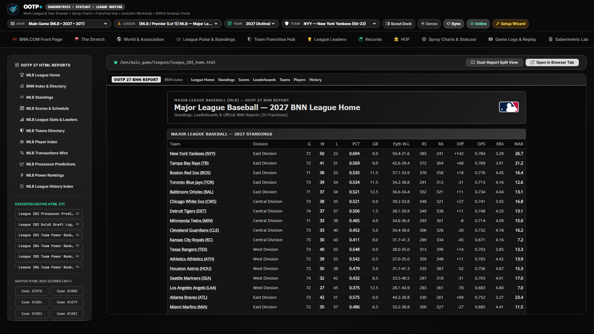

# OOTP HTML & BNN Almanac Portal

[← Previous: StatsPlus & Trade Machine](./11-statsplus-and-trade-machine.md) • [Documentation Index](./README.md) • [Next: Player Dossier & Scout Dock →](./13-player-dossier-and-scout-dock.md)

---

The **OOTP HTML & Almanacs Portal** (`bnn`) embeds native OOTP Baseball News Network (BNN) HTML reports (`news/html/`) and multi-decade historical almanacs (`news/almanac_YYYY/`) directly inside **OOTP+**, complete with automatic broken-link repair, dynamic SQLite fallback generation, and an ultrawide dual-pane reader (`app/bnn_generator.py`).

---

## Key Capabilities & Functions

### 1. Unified BNN Report & Historical Almanac Catalog (`GET /api/bnn/catalog`)
- Automatically indexes your active `.lg` folder's `news/html/` directory and every archived `news/almanac_YYYY/` folder on disk.
- Provides quick-jump category buttons for **League Home**, **Standings**, **Leaderboards**, **Team Index**, **Draft / Transactions**, **Top Prospects**, **Hall of Fame**, and **Archived Season Almanacs**.

### 2. Automatic Link, Logo & Stylesheet Rewriter
- Native OOTP HTML files often rely on brittle relative file paths (`../images/team_logos/...`, `../styles.css`) that break when served over HTTP or moved across machines.
- OOTP+'s `rewrite_ootp_html_content` engine dynamically rewrites internal navigation links, stylesheet references, player headshots, and team/league logo paths through `/bnn/{save_slug}/{path}` and `/ootp_asset/{save_slug}/{asset_type}/{filename}`—supplying crisp high-contrast SVG badge fallbacks whenever an image file is missing on disk.

### 3. Zero-Export Dynamic SQLite-to-BNN Fallback Renderer
- Even if you **never exported HTML reports** inside OOTP (only CSV data), OOTP+'s `generate_dynamic_bnn_html` synthesizer dynamically builds BNN-styled league index, standings, team roster, and player report pages directly from your ingested SQLite database so the portal always works out of the box.

### 4. Ultrawide Dual-Pane Split Reader (`Split View`)
- Click **Toggle Split View** (`toggleBnnSplitMode()`) in the BNN toolbar to divide the viewport into independent **Left Pane** and **Right Pane** readers.
- Ideal on widescreen and ultrawide monitors for comparing two historical almanac years (e.g., `2038 Almanac` vs. `2049 Almanac`), two team rosters, or draft classes side-by-side.

---

[← Previous: StatsPlus & Trade Machine](./11-statsplus-and-trade-machine.md) • [Documentation Index](./README.md) • [Next: Player Dossier & Scout Dock →](./13-player-dossier-and-scout-dock.md)
