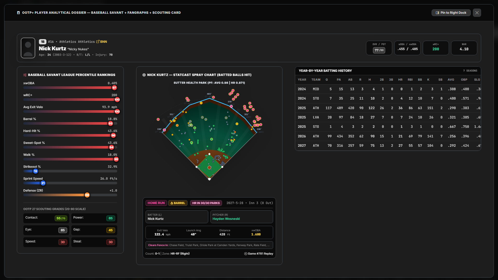
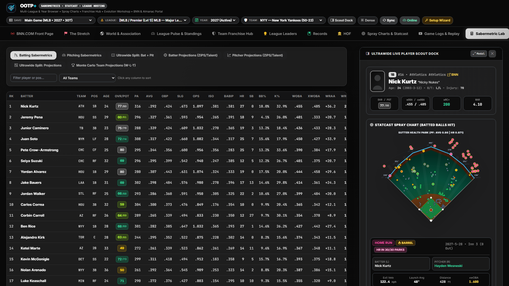

# Player Analytical Dossier & Ultrawide Live Scout Dock

[← Previous: OOTP HTML & BNN Almanacs](./12-bnn-html-and-almanacs.md) • [Documentation Index](./README.md) • [Next: Architecture & REST API Reference →](./14-architecture-and-api-reference.md)

---

Every player name across **OOTP+**—whether in the BNN.COM Front Page, Standings, Team Depth Chart, Sabermetric Lab, Spray Charts, Hall of Fame, Trade Machine, or the top-bar **Quick-Scout Player** search—is clickable and opens the **OOTP+ Player Analytical Dossier** (`GET /api/player/{player_id}`).

---

## 1. 3-Column Player Analytical Dossier Modal

Modeled on a unified **Baseball Savant + FanGraphs + OOTP Scouting Card**, the dossier presents a complete 360-degree evaluation of any hitter or pitcher:

- **Biographical & Contract Header:**
  - Player portrait, team logo, uniform/position/role tags, age, bats/throws handedness, height/weight, nationality/birthplace, service time, current contract salary/years, morale/personality traits, and career trophy-case award badges (`MVP`, `Cy Young`, `All-Star`, `Gold Glove`, `Silver Slugger`, `ROY`, `HOF`).
- **Column 1 — Baseball Savant Percentile Sliders (`1st–99th`):**
  - Red-to-blue Savant percentile bars ranking the player against all qualified league peers across:
    - **Batters:** `xwOBA`, `wOBA`, `wRC+`, `Exit Velocity`, `Barrel %`, `Hard-Hit %`, `K%`, `BB%`, `Sprint / Baserunning`, `Fielding ZR`, and `WAR`.
    - **Pitchers:** `ERA+`, `FIP`, `xFIP`, `K%`, `BB%`, `K-BB%`, `WHIP`, `HR/9`, `Opponent Exit Velo`, and `WAR`.
- **Column 2 — `20–80` Current vs. Potential Scouting Report & Pitch Arsenal:**
  - Dual-layer scouting bars displaying current grade vs. potential ceiling across **Contact**, **Gap Power**, **Home Run Power**, **Eye / Discipline**, **Avoid K's** (or **Stuff**, **Movement**, **Control**, **Stamina**, and individual pitch grades for `Fastball`, `Slider`, `Curveball`, `Changeup`, `Sinker`, `Cutter`, `Splitter`), plus defensive positional ratings and speed/stealing grades.
- **Column 3 — Personal Ballpark Spray Chart & Contact Profile:**
  - Embedded SVG stadium spray chart plotting every tracked batted ball for that specific hitter (or allowed by that pitcher), paired with directional Pull / Center / Oppo percentages and exit-velocity metrics.
- **Full FanGraphs Year-by-Year Career Ledger:**
  - Complete chronological season-by-season statistical table across Major League and Minor League stops with career totals, peak seasons highlighted, and postseason/streak logs.

---

## 2. Ultrawide Live Player Scout Dock (`Pin to Right Dock`)

On widescreen and ultrawide (`1280px–2400px+`) monitors, you don't have to close a player card to keep browsing tables:

1. Click **Pin to Right Dock** inside any Player Analytical Dossier modal (or click **Scout Dock** in the top Command Bar).
2. The player's scouting bars, Savant percentiles, spray chart, and career summary dock persistently along the right edge of your workspace (`#ultrawide-side-dock`).
3. While the Scout Dock is open, clicking any player row in the **Sabermetric Lab**, **League Leaders**, **Team Roster**, or **Trade Machine** updates the docked card instantaneously—and clicking **Modal** expands the docked player back into the full 3-column ultrawide view.

---

[← Previous: OOTP HTML & BNN Almanacs](./12-bnn-html-and-almanacs.md) • [Documentation Index](./README.md) • [Next: Architecture & REST API Reference →](./14-architecture-and-api-reference.md)
