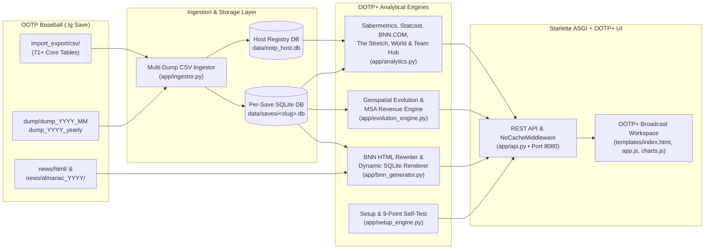

# System Architecture, SQLite Data Pipeline & REST API Reference

[← Previous: Player Dossier & Scout Dock](./13-player-dossier-and-scout-dock.md) • [Documentation Index](./README.md) • [Back to Main README →](../README.md)

---

**OOTP+** is built on an asynchronous Python 3.10+ (`Starlette` + `Uvicorn`) backend paired with index-optimized `SQLite3` (`WAL` mode) databases and a zero-build responsive HTML5 / Tailwind / Chart.js / SVG single-page frontend.

---

## 1. End-to-End Data Pipeline



### Core Engineering Pillars

1. **Multi-Source Save Discovery & Chunked SQLite WAL Ingestion (`app/ingestor.py`, `app/config.py`):**
   - Scans all candidate OOTP 27 / 26 / 25 `saved_games` directories plus `data/uploaded_saves/`.
   - Streams large historical CSV tables (`>20 MB`) in chunks, builds composite B-tree indexes across `player_id`, `team_id`, `league_id`, `year`, and `split_id`, and enables SQLite `WAL` (Write-Ahead Logging) for fast analytical reads.
   - **Smart Offseason & Preseason Fallback:** Automatically detects `0`-game header-only preseason exports and falls back seamlessly to the latest completed-season dump or historical career tables so standings, leaderboards, and Statcast views never render blank.
   - **Longitudinal Rating & Team Snapshots:** Aggregates across every `dump_YYYY_MM` and `dump_YYYY_yearly` subdirectory to populate `dump_player_rating_snapshots` and `dump_team_snapshots`.
2. **Dynamic League-Environment Sabermetrics (`app/analytics.py`):**
   - Computes per-league, per-year run-environment baselines (`lgAVG`, `lgOBP`, `lgSLG`, `lgwOBA`, `cFIP`, `RPW`) dynamically rather than relying on static MLB constants.
3. **Always-Fresh Server Lifecycle (`run_server.py`, `app/api.py`):**
   - `run_server.py` automatically detects and terminates stale processes holding port `8080` before starting Uvicorn, while `NoCacheMiddleware` enforces `Cache-Control: no-store, no-cache, must-revalidate, max-age=0`.

---

## 2. Project Directory Layout

```text
OOTP Hosting/
├── app/
│   ├── __init__.py               # Package initialization
│   ├── analytics.py              # Sabermetrics, Statcast, Team Hub, 5-Yr Roadmap, Leaders,
│   │                             #   Records, HOF JAWS, BNN.COM Portal, The Stretch & World Hub
│   ├── api.py                    # Starlette ASGI routes, Setup API, asset servers & NoCacheMiddleware
│   ├── bnn_generator.py          # BNN HTML catalog, link rewriter & SQLite-to-HTML fallback renderer
│   ├── config.py                 # User config persistence, OOTP path auto-discovery & spray zone math
│   ├── evolution_engine.py       # Geospatial Evolution Hub, MSA capacity/revenue model & roadmaps
│   ├── ingestor.py               # Multi-dump CSV parser, offseason fallback & SQLite WAL ingestion
│   ├── irl_counterparts.py       # Real-life MLB/MiLB/Indy franchise registry, MSA pops & Haversine math
│   └── setup_engine.py           # Setup Wizard backend, 16-team Demo League generator & 9-point verifier
├── data/
│   ├── saves/                    # Per-save SQLite databases (<save_slug>.db, auto-generated)
│   ├── uploaded_saves/           # Staging directory for .zip online league imports & Demo League
│   ├── ootp_host.db              # Master registry of discovered saves, dumps, almanacs & roadmaps
│   └── user_config.json          # Persisted user configuration (saved_games_dir, port, default save)
├── docs/                         # Screen-by-screen functional documentation & architecture guides
├── screenshots/                  # High-resolution screenshots of every OOTP+ screen, sub-view & modal
├── static/
│   ├── css/app.css               # Broadcast dark/light styles, glassmorphism & Set 2 brand tokens
│   ├── favicons/                 # Optical favicons (16-64px, .ico, SVG), PWA manifest, maskable & OG card
│   ├── img/                      # Official Set 2 OOTP+ brand logos, high-DPI icons & UX SVG components (ux/)
│   ├── js/app.js                 # Frontend SPA controller, 14 hub renderers, modals & table sorting
│   ├── js/charts.js              # Chart.js visualizers, SVG ballpark spray charts & expansion maps
│   └── ootp27_hub.ico            # Multi-size (16-256px) Set 2 Windows desktop shortcut icon
├── templates/
│   └── index.html                # Responsive HTML5 shell, Command Bar, Scout Dock & modals
├── create_shortcut.ps1           # PowerShell script to generate Windows Desktop shortcut
├── Launch_OOTP27_Hub.bat         # One-click Windows launcher
├── Launch_OOTP27_Hub.vbs         # Silent windowless background desktop app launcher
├── Setup_Wizard.bat              # One-click interactive Setup & 9-Point Verification Wizard
├── setup_wizard.py               # CLI Setup Wizard, auto-dependency installer & diagnostic runner
├── requirements.txt              # Python dependencies (uvicorn, starlette, pandas, numpy, aiofiles)
└── run_server.py                 # ASGI server entry point with stale-port cleanup & auto-demo fallback
```

---

## 3. REST API Reference

All endpoints are served asynchronously on `http://localhost:8080`.

### Setup & Diagnostic Endpoints

| Method | Endpoint | Description |
| :--- | :--- | :--- |
| `GET` | `/api/setup/status` | Returns Python/SQLite health, candidate OOTP folders, discovered `.lg` saves, and CSV export guide. |
| `POST` | `/api/setup/config` | Updates `data/user_config.json` (`saved_games_dir`, `default_save_slug`, `port`) and refreshes saves. |
| `POST` | `/api/setup/browse` | Opens a native OS folder selection dialog and returns the normalized directory path. |
| `POST` | `/api/setup/demo` | Generates and ingests the bundled multi-season `OOTP27_Demo_League.lg` save. |
| `GET`/`POST` | `/api/setup/verify` | Executes the 9-point end-to-end functionality verification suite against the active save. |
| `POST` | `/api/setup/shortcut` | Runs `create_shortcut.ps1` to create a Windows Desktop shortcut. |

### Save Management & Analytical Endpoints

| Method | Endpoint | Query / Body Parameters | Description |
| :--- | :--- | :--- | :--- |
| `GET` | `/api/saves` | — | Lists all discovered saves from `ootp_host.db` and returns the active `save_slug`. |
| `POST` | `/api/saves/select` | `{save_slug, force, source_label}` | Switches active save or chronological dump and runs SQLite ingestion. |
| `POST` | `/api/saves/upload` | `?name=<LeagueName>` (raw `.zip`) | Extracts an uploaded online league `.zip` export and builds its SQLite DB. |
| `GET` | `/api/frontpage` | `save`, `league_id`, `year`, `headline_mode` | Powers the **BNN.COM \| OOTP+ Portal** and **Broadsheet Gazette**. |
| `GET` | `/api/stretch` | `save`, `league_id`, `league_ids`, `year` | Powers **"The Stretch"** pennant races, playoff odds, momentum worms & brackets. |
| `GET` | `/api/world_dashboard` | `save`, `year` | Powers the **World & Association Dashboard** ecosystem matrix, org pyramid & MLEs. |
| `GET` | `/api/overview` | `save`, `league_id`, `team_id`, `year` | Powers **League Pulse & Standings**, run-environment constants & recent box scores. |
| `GET` | `/api/team_dashboard` | `save`, `league_id`, `team_id`, `year` | Powers the **Team Franchise Hub** depth chart, 27-metric rankings & 5-year roadmap. |
| `GET` | `/api/leaders` | `save`, `league_id`, `year`, `split_id` | Powers **League Leaders** across batting, pitching, fielding & Statcast cards. |
| `GET` | `/api/records` | `save`, `league_id` | Powers the **League Records Book** (single-season, career, single-game & streaks). |
| `GET` | `/api/hof` | `save`, `league_id` | Powers the **Cooperstown Hall of Fame & JAWS Museum** plaques, JAWS & watchlist. |
| `GET` | `/api/spray` | `save`, `player_id`, `opponent_id`, `team_id`, `game_id`, `park_id`, `result`, `limit` | Powers **Spray Charts & 3D Statcast** coordinates, stadium walls & directional splits. |
| `GET` | `/api/games` | `save`, `game_id`, `team_id`, `limit` | Powers **Game Logs & Replay Center** line scores, box scores & play-by-play steps. |
| `GET` | `/api/sabermetrics` | `save`, `league_id`, `team_id`, `split_id`, `min_pa`, `min_ip`, `year` | Powers **Sabermetric Lab** batting/pitching tables and quadrant scatter datasets. |
| `GET` | `/api/projections` | `save`, `league_id`, `team_id`, `year` | Powers hybrid true-talent player and team statistical projections. |
| `GET` | `/api/evolution` | `save`, `league_id`, `year` | Powers **League Evolution** readiness scores, MSA market revenue/capacity & health. |
| `GET`/`POST` | `/api/evolution/roadmap` | `save`, `league_id` (or JSON body) | Loads or saves custom multi-phase Expansion & Realignment Roadmaps. |
| `GET` | `/api/statsplus` | `save`, `league_id`, `team_id`, `year` | Powers **StatsPlus** rating deltas, Top 100 prospects, farm ranks, contracts & trades. |
| `GET` | `/api/player/{player_id}` | `save` | Powers the **Player Analytical Dossier** & **Ultrawide Live Scout Dock**. |
| `GET` | `/api/bnn/catalog` | `save`, `league_id` | Lists native BNN HTML reports and historical almanacs. |
| `GET` | `/bnn/{save_slug}/{path}` | — | Serves link-rewritten BNN HTML reports or dynamic SQLite-rendered BNN pages. |
| `GET` | `/ootp_asset/{save_slug}/{asset_type}/{filename}` | — | Serves team logos, league logos, park images, and player headshots with SVG fallbacks. |

---

## 4. Configuration & Environment Variables

Settings configured in the Setup Wizard persist in `data/user_config.json`:

```json
{
  "saved_games_dir": "C:\\Users\\<User>\\Documents\\Out of the Park Developments\\OOTP Baseball 27\\saved_games",
  "extra_save_dirs": [],
  "port": 8080,
  "host": "0.0.0.0",
  "app_mode": true,
  "setup_completed": true,
  "default_save_slug": "main_game"
}
```

Optional environment variable overrides:
- `OOTP_SAVED_GAMES_DIR`: Override path to your OOTP `saved_games` directory.
- `OOTP_PORT`: Override HTTP port (default: `8080`).
- `OOTP_HOST`: Override bind address (default: `0.0.0.0`).

---

[← Previous: Player Dossier & Scout Dock](./13-player-dossier-and-scout-dock.md) • [Documentation Index](./README.md) • [Back to Main README →](../README.md)
