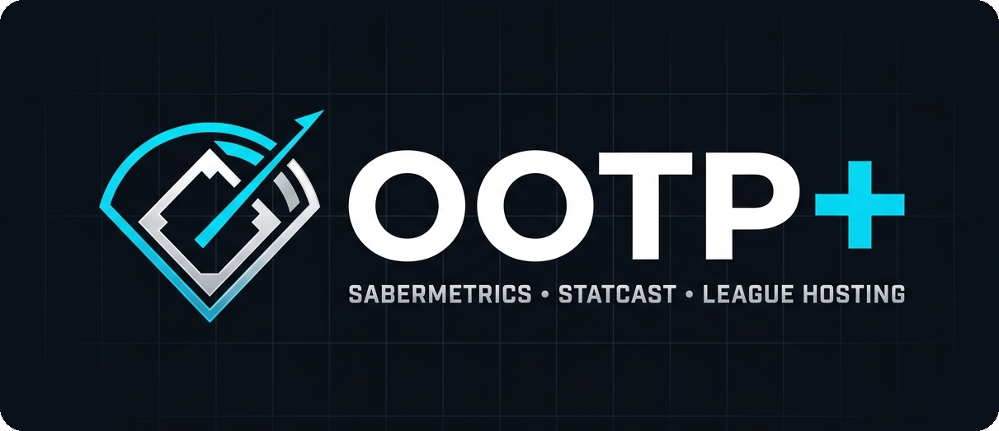
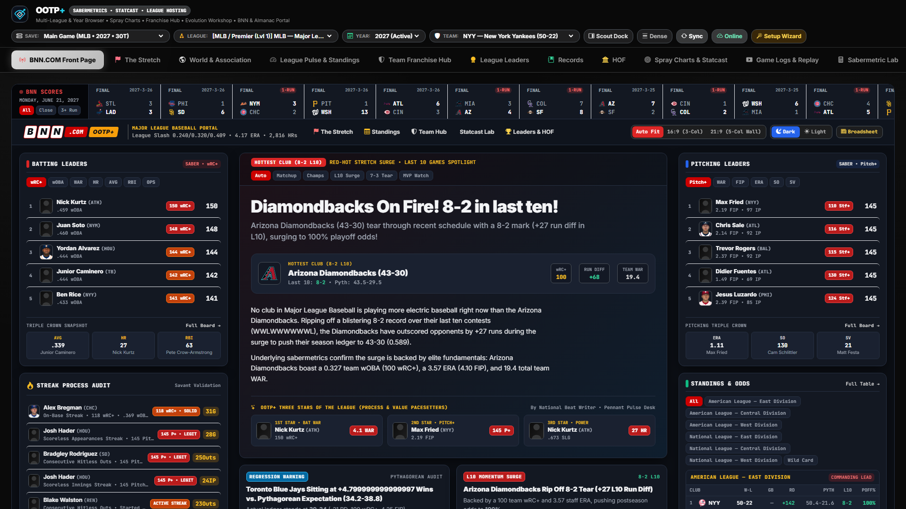
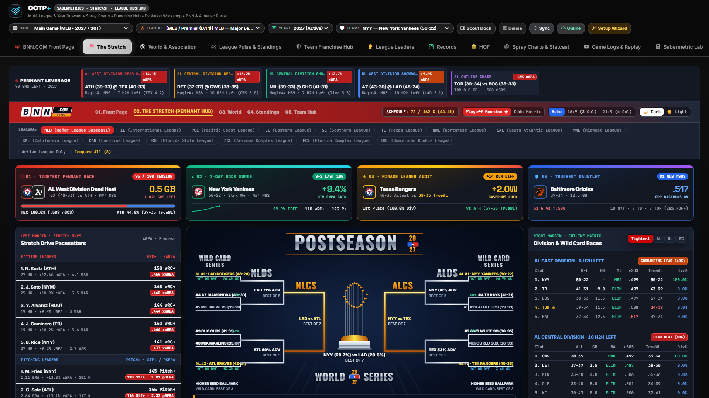
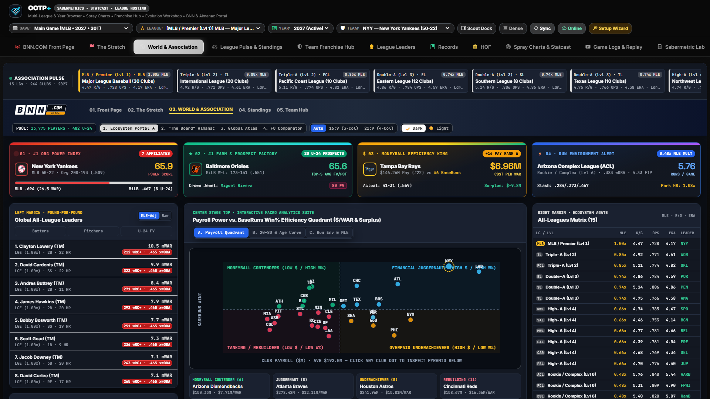
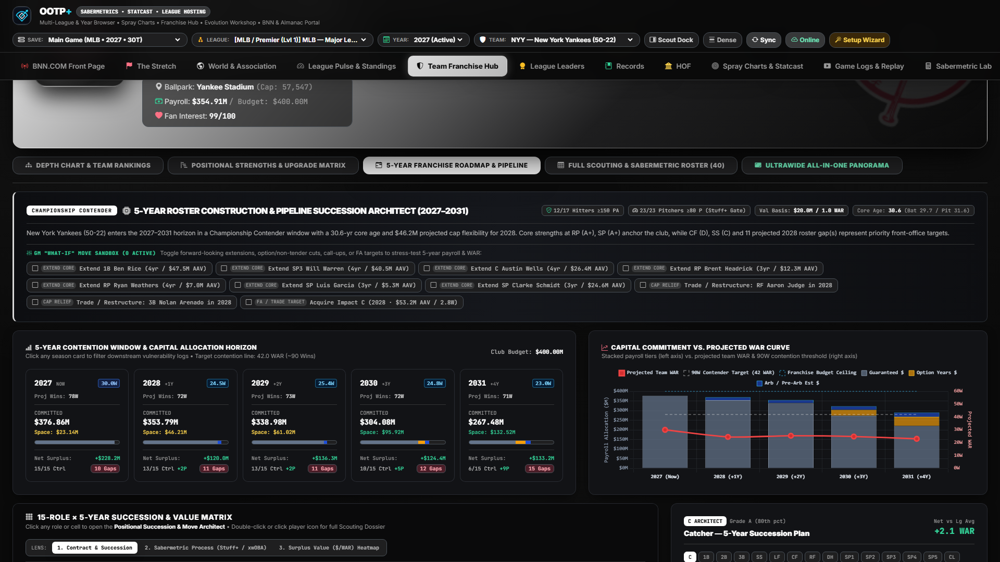
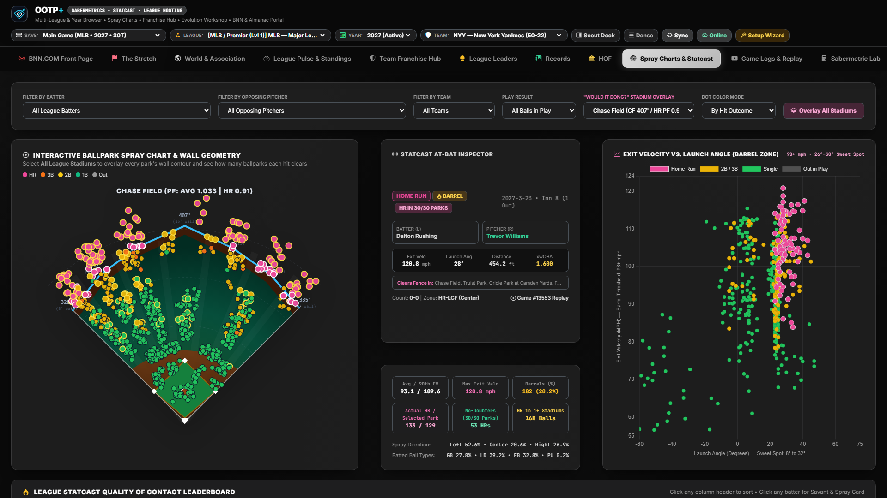
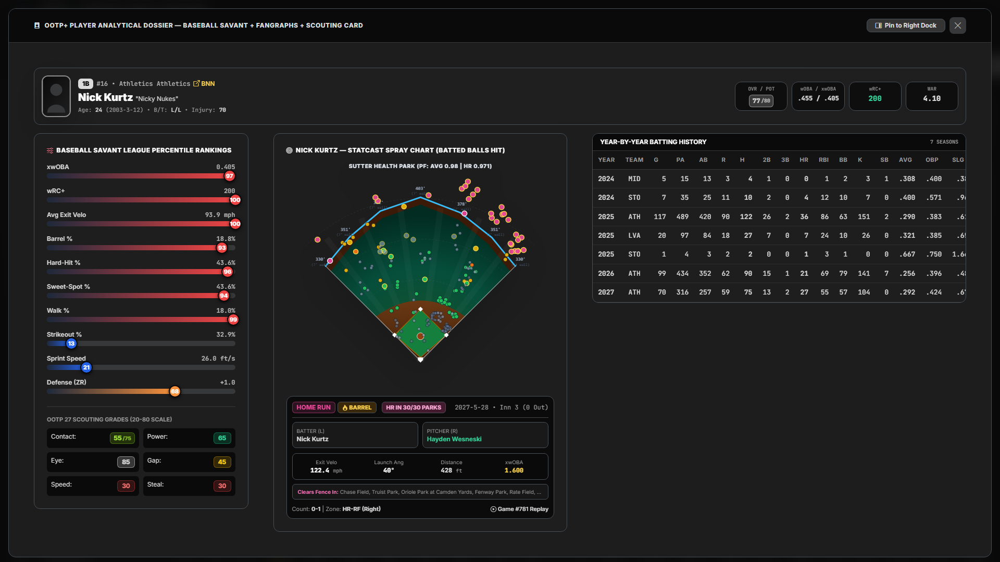

  

  # OOTP+ Documentation & Screen Guide
  **Complete Screen-by-Screen Reference, Analytical Methodologies & API Documentation**

  [← Return to Main README & Getting Started Tutorial](../README.md)

---

Welcome to the **OOTP+** documentation directory. Each guide below explains an individual screen, its interactive controls and sub-views, the underlying sabermetric or economic calculations, and annotated screenshots from a live save.

---

## Screen & Function Guides

| # | Screen / Module Guide | Primary Screens & Functions Covered |
| :-: | :--- | :--- |
| **01** | [**Command Bar, Setup Wizard & Online Import**](./01-command-bar-and-setup.md) | Global Save / League / Year / Dump / Team switchers, Quick-Scout search, Dense mode, 4-Step Setup & 9-Point Self-Test Wizard, and Online League `.zip` Import Center. |
| **02** | [**BNN.COM \| OOTP+ Portal & Front Page Gazette**](./02-bnn-front-page-and-gazette.md) | Live broadcast scoreboard ticker, interactive game recap switcher, Three Stars of the League, process leaderboards, and the Classic Broadsheet Newspaper Gazette. |
| **03** | [**"The Stretch" — Pennant & Postseason Hub**](./03-the-stretch-pennant-hub.md) | Multi-league pennant races, Wild Card cutlines, Magic Numbers, Season Momentum Worm charts, adaptive October / *"If Season Ended Today"* Playoff Brackets, and Monte Carlo Contender Matrix. |
| **04** | [**World & Association Ecosystem Dashboard**](./04-world-and-association.md) | All-Leagues comparison matrix, Organizational Pyramid & Affiliate Power Index (`0–100`), Financial Efficiency Quadrant, MLE Pound-for-Pound translator, International Pipelines, and Org Comparator. |
| **05** | [**League Pulse & Pythagorean Standings**](./05-league-pulse-and-standings.md) | Dynamic run-environment & `cFIP` telemetry, Season Year quick-switcher, recent box scores, and Pythagorean / BaseRuns (`BsR`) standings matrices. |
| **06** | [**Team Franchise Hub & 5-Year Roadmap**](./06-team-franchise-hub.md) | Interactive Diamond Depth Chart with `A+`–`D` unit grades, **27-Metric League Statistical Rankings**, **5-Year Projected Starters Grid (15 Roles × 5 Years)**, Gap Action Plan, and Contract/Age-Curve Matrix. |
| **07** | [**League Leaders, Records & Hall of Fame (JAWS)**](./07-leaders-records-and-hof.md) | Top-10 visual leader cards across Batting/Pitching/Fielding/Statcast, All-Time Single-Season & Career Records Book, and Cooperstown Hall of Fame plaques with positional **JAWS** & Black/Gray Ink. |
| **08** | [**Spray Charts, 3D Statcast & Game Replay**](./08-statcast-and-game-replay.md) | Ballpark polar coordinate spray charts (`angle_deg`, `distance_ft`, exit velo, barrels) and the interactive pitch-by-pitch / at-bat **Game Logs & Play-by-Play Replay Center**. |
| **09** | [**Sabermetric Lab & Hybrid Projections**](./09-sabermetric-lab-and-projections.md) | League-calibrated `wOBA`, `xwOBA`, `wRC+`, `OPS+`, `FIP`, `xFIP`, `ERA+`, `ZR`, `WAR`, handedness splits, quadrant scatter plots, and ZiPS-style true-talent projections. |
| **10** | [**League Evolution & Expansion Workshop**](./10-league-evolution-and-expansion.md) | Expansion Readiness Index, MSA market capacity & revenue modeling (`Gate / Media / Merch`), clickable SVG geographic expansion map, multi-phase roadmaps, and Haversine divisional realignment. |
| **11** | [**StatsPlus Portal & Interactive Trade Machine**](./11-statsplus-and-trade-machine.md) | Multi-dump Player Development rating tracker, Top 100 Prospects & Farm Rankings, `$/WAR` Contract Surplus Matrix, and live two-team **Interactive Trade Machine**. |
| **12** | [**OOTP HTML & BNN Almanac Portal**](./12-bnn-html-and-almanacs.md) | Embedded native OOTP BNN HTML & historical Almanac browser, automatic broken-link/logo rewriter, zero-export SQLite-to-HTML fallback renderer, and Ultrawide Split View. |
| **13** | [**Player Analytical Dossier & Live Scout Dock**](./13-player-dossier-and-scout-dock.md) | 3-Column Baseball Savant percentile + `20–80` scouting + FanGraphs career modal, personal spray chart, and the pinnable right-hand **Ultrawide Live Player Scout Dock**. |
| **14** | [**Architecture, Data Pipeline & REST API**](./14-architecture-and-api-reference.md) | Mermaid data-flow architecture, multi-dump SQLite WAL ingestion & preseason fallback logic, directory structure, configuration files, and complete REST API endpoint reference. |

---

## Visual Overview Gallery

| BNN.COM \| OOTP+ Broadcast Portal | "The Stretch" Pennant & Playoff Hub |
| :---: | :---: |
|  |  |
| **World & Association Dashboard** | **Team Franchise Hub & 5-Year Roadmap** |
|  |  |
| **Spray Charts & 3D Statcast** | **Player Analytical Dossier** |
|  |  |
